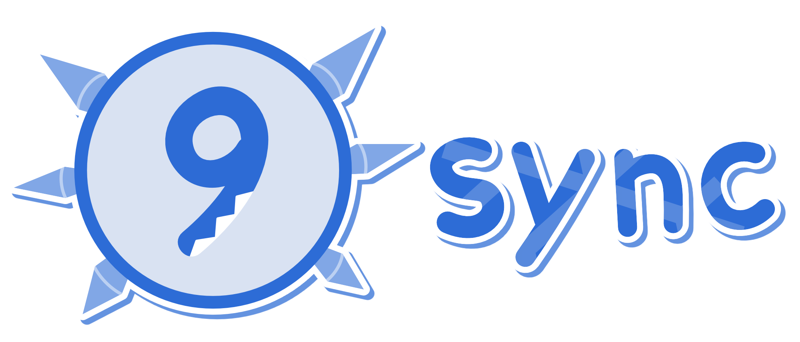

  

NineSync brings MikuMikuDance (MMD) projects into Blender. Import and sync PMM projects, including model animations, morphs, cameras, lighting, audio, accessories and certain MME effects.

## Project Scope

NineSync is developed across two components:

- **(Core) [PMM Bridge](https://github.com/sen-trie/nine-sync-core):** Syncs MMD projects, animations, morphs, cameras, lighting and audio.
- **(FX) [FX Importer](https://github.com/sen-trie/nine-sync-fx):** Imports `.x` accessories and applies supported `.fx` effects.

## Requirements

- Blender 5.3+
- [mmd_tools](https://extensions.blender.org/add-ons/mmd-tools/) 4.5.5+

## Installation

1. In Blender, open **Edit > Preferences > Get Extensions**.
2. Open the repositories menu and choose **Add Remote Repository**.
3. Enter `https://sen-trie.github.io/nine-sync-release/index.json`.
4. Find and install **NineSync**.

Alternatively, download the NineSync ZIP from [GitHub Releases](https://github.com/sen-trie/nine-sync-release/releases) and use **Install from Disk** in Blender's extension preferences.

Install the combined extension **or** the two standalone add-ons, not both at once.

## Getting started

1. Open Blender's **3D Viewport** and press **N** to show the sidebar.
2. Select the **NineSync** tab.
3. Choose your MMD `.pmm` project and set up the models you want to sync.
4. Click **Sync Now** to import or update the project.

You can also import `.x` accessories directly with **File > Import > MMD Accessory (.x)**.

## Documentation

Guides and manuals: [ninesync-docs.sentrie.workers.dev](https://ninesync-docs.sentrie.workers.dev/)

Check the wiki for more details.

## Contributing

Report problems in this repository's issue tracker. To change code, open a pull request in the repository that owns it: [nine-sync-core](https://github.com/sen-trie/nine-sync-core) or [nine-sync-fx](https://github.com/sen-trie/nine-sync-fx). Documentation, packaging, translations and release changes belong here. See [CONTRIBUTING.md](CONTRIBUTING.md) for the short version and the [Developer Guide](DEVELOPER_GUIDE.md) for setup, architecture, tests, translations and the use of AI coding tools.

## License

Copyright 2026 sentrie. GPL-3.0-or-later. See `LICENSE`.
