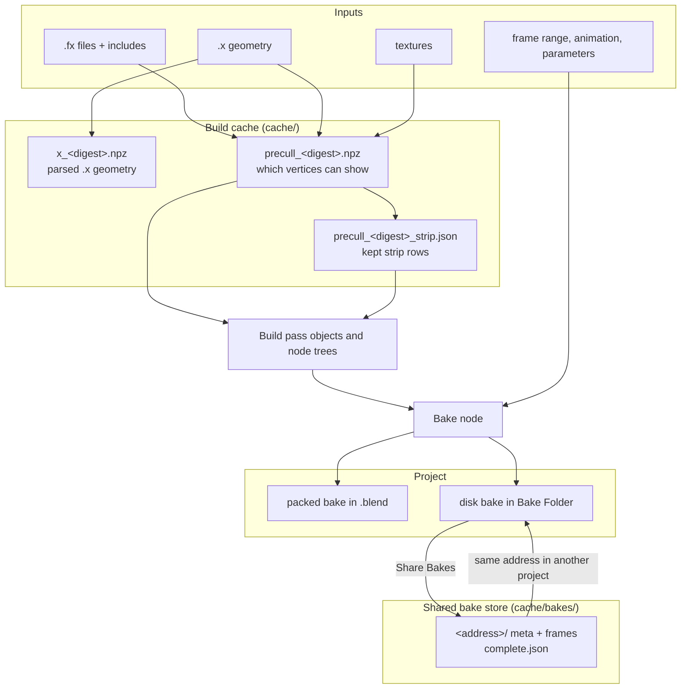

# Cache Architecture

For performance reasons, FX keeps three different kinds of stored data.

<!-- prettier-ignore -->
| | **Build cache** | **Shared bake store** | **Project-local bakes and data** |
|---|---|---|---|
| Answers | "Which vertices can I skip? What does this `.x` contain?" | "Has this exact effect and animation been baked before?" | "What does *this project* show?" |
| Lives in | the `cache` folder | `cache/bakes/<address>/` | in the `.blend` (packed) or in your **Bake Folder** |
| Keyed by | the **content** of the inputs | the **content** of the inputs and the animation | the pass object |
| Shared between projects | yes | yes, only when **Share Bakes** is on | no |
| Size limit | **Cache Limit**, 512 MB default | **Shared Bake Limit**, 4096 MB default | none |
| Cleared by | **Clear Effect Caches** | **Clear Shared Bakes** | **Clear All** (bakes), **Clean Accessories** |

## The build cache

**Where.** A folder named `cache` beside your node library (the user folder of the add-on), or the folder you choose in
the add-on preferences (**Cache Folder**). Set the same folder in a standalone FX install and in the bundled add-on to let
them share it. Without a user folder, the system temp folder is used.

| File                          | Contents                                                                                  | Used for                                 |
| ----------------------------- | ----------------------------------------------------------------------------------------- | ---------------------------------------- |
| `x_<digest>.npz`              | the `.x` file parsed into numpy arrays                                                    | skipping `.x` parsing                    |
| `precull_<digest>.npz`        | for each probed condition, which vertices are kept and which gates open                   | skipping [pre-cull](culling.md#pre-cull) |
| `precull_<digest>_strip.json` | the rows kept by [strip simplification](culling.md#strip-simplification), per run of rows | skipping strip analysis                  |

**What it is for.** Pre-cull is the slow part of a first build (39.7 s of 49.8 s for Thunder in the
[measured run](culling.md#a-real-run-thunder-lv2)). Cached, the same build took 3.4 s.

### How keys are built

Keys are MD5 hashes of the _content_ that determines the result, so a file renamed or copied elsewhere hits the same
entry:

- **`.x` file:** `md5(content digest of the .x | MME_CORE_VERSION)`.
- **Pre-cull file:** `md5` over `MME_PRECULL_VERSION`, the Blender version, the digests of the `.fx` files, the digest of
  the `.x`, the digest of the textures, the technique, pass, subset and draw order, the count and sum of the used
  vertices, the alpha gates and extra loop information.
- **Strip entry** (inside the strip file): `md5` over `MME_STRIP_CACHE_VERSION`, the probe-condition signature, the camera
  matrices, the tolerance, loop instances, density and the first and last row.

When the cache format changes, old entries are invalidated.

<!-- prettier-ignore -->
!!! example "Measured: a renamed copy"
    Thunder was built cold (49.8 s), built again (3.4 s), then copied to another folder under a new name and built
    again: **3.5 s**, with the log line `57 of 57 visibility states known` and an unchanged number of cache files. The
    cache did not care about the name or the folder.

### Size and eviction

- The limit is **512 MB** by default (**Cache Limit (MB)** in preferences).
- Files are removed **least recently used first**, by modification time. A cache hit _touches_ the file, so something you
  keep using stays.
- Writes are **atomic**: written to a temporary file and moved into place (`os.replace`), so a crash cannot leave a
  half-written cache file that is later trusted.
- After one Thunder effect, the cache folder was about **7.3 MB**: a 7.27 MB `x_*.npz` and small `precull_*` files.

**Pre-cull Cache** (in settings) turns the pre-cull and strip entries off. It does not affect baking.

## Shared bake store

A bake can take a long time and big disk space. Often the same effect with the same animation is baked in many
projects (a stage you reuse, a render you restart). With **Store: Disk** and **Share Bakes** on, FX keeps the bake in a
shared folder named by an **address**: a hash of everything that determines the baked frames.

`cache/bakes/<address>/`

| Entry                     | Meaning                                                   |
| ------------------------- | --------------------------------------------------------- |
| `meta/<frame>_.json` | one record per baked frame, written by Blender            |
| frame data                | the baked geometry for the frames                         |
| `complete.json`           | written _last_: `{v, key, frames: [start, end], created}` |

### What goes into the address

The **portable bake address** (`mme_portable_bake_sig`) is built from the _bake signature_:

- the pass's build signature (the same one used for [incremental rebuilds](index.md#incremental-rebuilds));
- the frame range, the bake target, the transform chain of the pass object, undriven modifier inputs;
- driver expressions and targets;
- **the node graph** itself (editing a node upstream of the Bake node changes the signature, so the bake is
  recognised as stale).

and then made _portable_ by **leaving out** the bake directory, layout, target, and the **object and root names**, and
**adding** the Blender version, `MME_CORE_VERSION` and the store version (`MME_BAKE_STORE_VERSION = 1`).

Leaving out names is why two projects with differently named objects but the same effect and animation get the same
address. Adding the versions is why a Blender or FX upgrade that could change the result does not reuse an old bake.

### Publishing without half-finished bakes

1. A bake writes into a private folder `_tmp_<address>_<pid>_<random>`.
2. When it finishes, `complete.json` is written inside it.
3. The folder is **renamed** to `<address>`. If another process published the same address first, that copy is kept and
   this one is discarded.
4. A reader only trusts a folder that has `complete.json`, with the right version and frame range, and with a record for
   **every** frame in the range.

An interrupted bake or one made by another Blender never looks finished. `_tmp_` folders older than **24 hours** are
swept.

### Size and eviction

- **Shared Bake Limit (MB)**: 4096 by default.
- After each publish, the store deletes the **least recently used** bakes (by `complete.json` modification time, touched on
  every hit) until it fits.
- A project that still points at a deleted bake finds frames missing and **rebakes**.

<!-- prettier-ignore -->
!!! warning "Clear All does not delete shared bakes"
    **Clear All** removes bakes from the project. For a pass that is using a bake that lives in the _shared_ store, it
    **unlinks** the pass from it (`mme_clear_bake`) and does not delete the shared files, because other projects may be
    using them. To delete shared bakes, use **Clear Shared Bakes**.

## Project-local bakes

| Store                 | Where it is                                 | Notes                                                                                                                                                             |
| --------------------- | ------------------------------------------- | ----------------------------------------------------------------------------------------------------------------------------------------------------------------- |
| **Packed in .blend**  | inside the file                             | grows the file; nothing else to manage                                                                                                                            |
| **Disk** (not shared) | the **Bake Folder** (default `//mme_bake/`) | with **Folder per Pass**, each pass gets its own folder named after the `.blend` and the pass key, so a _Save As_ copy never overwrites the bakes of the original |

The per-pass folder name uses the **pass key**, which already encodes the effect instance, technique, pass, subset and
order, and does not change when you rename an object. Blender only resolves `{blend_name}` in a bake directory
(object, modifier and scene names make it fall back to a packed bake), so the pass part is written literally.

**Bake Changed** compares each pass's recorded bake signature with its current inputs and rebakes only those that differ.
**Force Rebake All** ignores it.

<!-- prettier-ignore -->
!!! tip "Which one should I use?"
    - Working on one project: **Packed**, or **Disk** with the default folder.
    - Rendering the same effect in several projects, or on several machines pointing at a network cache folder: **Disk + Share Bakes**.
    - Sending a project to someone: **Packed**, or **Disk** with **Share Bakes** off and the bake folder next to the `.blend`.

## What clears what

| Action                     | Build cache  | Shared bakes     | Project bakes                               |
| -------------------------- | ------------ | ---------------- | ------------------------------------------- |
| **Clear Effect Caches**    | yes          | no               | no                                          |
| **Clear Shared Bakes**     | no           | yes              | no (passes will rebake if they point there) |
| **Clear All** (Bake panel) | no           | no, only unlinks | yes                                         |
| Cache limit reached        | oldest files | no               | no                                          |
| Shared limit reached       | no           | oldest bakes     | no                                          |

## Related pages

- Source: [`runtime/cache_store.py`](https://github.com/sen-trie/nine-sync-fx/blob/master/runtime/cache_store.py),
  [`runtime/bake_store.py`](https://github.com/sen-trie/nine-sync-fx/blob/master/runtime/bake_store.py),
  [`runtime/bake_paths.py`](https://github.com/sen-trie/nine-sync-fx/blob/master/runtime/bake_paths.py),
  [`runtime/precull.py`](https://github.com/sen-trie/nine-sync-fx/blob/master/runtime/precull.py)
