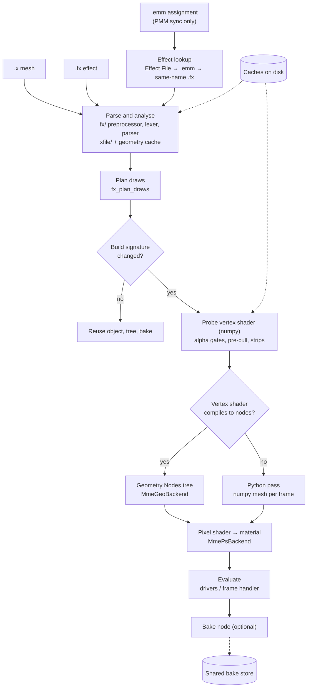

# FX Architecture

This page follows one request through FX: from the files MMD gave you to the objects, node groups and materials in
your `.blend`. The measurements come from a real effect, described in [one effect, end to end](#one-effect-end-to-end).

<!-- prettier-ignore -->
!!! info "Reading order"
    The page starts with the big picture, then goes deeper. You can stop after [the pipeline](#the-pipeline) and
    [one effect, end to end](#one-effect-end-to-end) and still understand what FX created. The other pages in this
    section go further:
    [MME translation](geometry-nodes-translation.md), [shader translation](shader-translation.md),
    [culling](culling.md), [caches](cache.md), [the shared library](shared-library.md).

## What MME effects are, in Blender terms

An MME effect is a `.fx` text file written in HLSL for the GPU. For your purposes it contains:

<!-- prettier-ignore -->
| In the `.fx` | What it is | What FX makes of it |
|---|---|---|
| **technique** | one way of drawing, chosen by `MMDPass` (`object`, `shadow`, `edge`…) and an optional `Subset` | FX uses `object` techniques (falling back to `object_ss`) and ignores `edge`, `shadow` and `zplot` techniques |
| **pass** | one draw call inside a technique | one **pass object** in Blender (a mesh with a Geometry Nodes modifier and a material) |
| **script** (`LoopByCount`, `LoopGetIndex`, `Pass=`) | repeats passes, so one pass draws the mesh N times | N copies of the mesh made inside the Geometry Nodes tree, each with its own index |
| **vertex shader** | decides where each vertex goes | a Geometry Nodes tree, or a Python (numpy) calculation |
| **pixel shader** | decides the colour and transparency of each pixel | a material: shader nodes |
| **parameters** (`float Speed = 1;`) | values the artist is meant to tune | custom properties on the accessory root |
| **`CONTROLOBJECT`** | reads another object, bone or morph from the MMD scene | a link to a Blender object, bone, morph or shape key |
| **render targets / `Draw=Buffer`** | off-screen buffers and full-screen passes | not supported; recorded and skipped |

A _subset_ is a group of faces of the `.x` that share one material. Each (technique, pass, subset) combination is a
**draw**. The effect's script can repeat a draw many times.

## The pipeline

```text
.x / .fx / .emm
      ↓
Parsing and analysis
      ↓
Draw planning (techniques, subsets, loops)
      ↓
For each draw:
   Vertex shader probing  →  Pre-culling and strip simplification
      ↓
Node generation (Geometry Nodes + material)  — or fallback to Python
      ↓
Evaluation (drivers, or a frame handler for Python passes)
      ↓
Baking (optional)
```



<!-- prettier-ignore -->
!!! note "The order differs from a naive reading"
    Culling happens **before** node generation, not after. FX evaluates the vertex shader once in numpy to find
    vertices and faces that can never be drawn, removes them from the mesh, and only then writes the Geometry Nodes tree
    for what is left. That is why the trees stay small. The same analysis is also what makes the caches valuable.

### Stage by stage

<!-- prettier-ignore -->
| Stage | What happens | Code |
|---|---|---|
| **Effect lookup** | choose the `.fx` (Effect File → `.emm` → same-name `.fx`) | `runtime/effect_files.py` |
| **Parse** | preprocess (includes, macros), lex, parse HLSL into a program; the parse is cached and validated by file modification times | `fx/preprocessor.py`, `fx/lexer.py`, `fx/parser.py` |
| **`.x` geometry** | parse the text `.x` and merge it into arrays; cached on disk by content | `xfile/`, `runtime/geometry_cache.py` |
| **Plan draws** | pick technique per subset, expand the script's loops, mark full-screen draws | `fx/techniques.py` (`fx_plan_draws`) |
| **Signature** | hash everything that decides one pass; decide *build* or *skip* | `runtime/manifest.py` |
| **Reduce** | alpha gates, pre-cull, strip simplification | `runtime/pruning.py`, `runtime/precull.py`, `runtime/strips.py` |
| **Generate** | Geometry Nodes tree for the vertex shader, material for the pixel shader | `nodes/geo_tree.py`, `nodes/material_compile.py` |
| **Evaluate** | drivers keep inputs current; Python passes recompute per frame | `nodes/drivers.py`, `runtime/drivers.py`, `runtime/update.py` |
| **Bake** | one Bake node per pass group | `runtime/bake.py`, `nodes/geo_tree.py` |

The orchestrator is `mme_build_effect` in `runtime/build_effect.py`; one pass is built by `mme_build_pass` in
`runtime/build_pass.py`.

## One effect, end to end

The example is a lightning effect (Thunder, level 2) built headless in Blender on a development machine. It is a
third-party effect and is not bundled with NineSync; only short excerpts are shown, as in any tutorial. Defaults:
`LineNum = 28`, `ParticleNum = 64`, `FlashNum = 1`, `WaveNum = 1`.

**1. The files.** One `.x` and one `.fx` of about 700 lines. Its techniques (shortened):

```hlsl
technique MainTec0 < string MMDPass = "object"; string Subset = "0"; string Script = "...LoopByCount=LineNum;LoopGetIndex=g_index;Pass=Paritcle;Pass=Flash;LoopEnd=;" > { ... }
technique MainTec1 < string MMDPass = "object"; string Subset = "1"; ... Pass=Line; ... Pass=Wave; ... >
technique MainTec2 < string MMDPass = "object"; string Subset = "2"; > { pass MainPass { ... } }
technique EdgeTec   < string MMDPass = "edge";   > {}
```

**2. Draw planning.** `fx_plan_draws` finds five draws: _Paritcle_ and _Flash_ (subset 0), _Line_ and _Wave_
(subset 1), _MainPass_ (subset 2). The `edge`, `shadow` and `zplot` techniques are ignored. Four draws loop 28 times
(`LineNum`).

**3. Reduction.** FX probes each vertex shader and removes what never shows:

<!-- prettier-ignore -->
| Pass | Faces in the `.x` subset | Faces kept | Why | Evaluated vertices (kept × 28 copies) |
|---|---:|---:|---|---:|
| Paritcle | 30,000 | 128 | 29,872 never drawn | 7,168 |
| Flash | 30,000 | 2 | 29,998 never drawn | 112 |
| Line | 20,000 | 138 | 19,862 always transparent | 3,920 |
| Wave | 20,000 | 314 | 19,686 merged along strips | 8,848 |
| MainPass | 1,984 | 0 | all never drawn → pass skipped | – |

**4. Generation.** Each kept pass becomes a Geometry Nodes group and a material. The _Line_ pass is shown in full on
the [translation page](geometry-nodes-translation.md#a-real-generated-graph).

**5. Timing, same machine, same Blender.** Cold build (empty cache): **49.8 s**, of which pre-cull 39.7 s and strips
6.7 s. Warm build (caches present): **3.4 s**, with identical face counts. A renamed copy of the same two files in
another folder also took 3.5 s, because the cache is keyed by file _content_. See [Cache Architecture](cache.md).

<!-- prettier-ignore -->
| Default parameters | `MainColor` changed |
|---|---|
| { width=420 } | { width=420 } |
| Rendered in EEVEE at Tr = 0.5 | The same built effect after setting `MainColor` to (2, 0.25, 0.05): a live change, no rebuild |

_(The two images are the same built effect with one parameter changed. They are rendered stills, not a viewport capture.)_

## Geometry Nodes or Python

Each pass is built by one of two backends. Both start from the same interpreter (`FxExec`), which runs the HLSL
functions; they differ in what they _emit_:

<!-- prettier-ignore -->
| | Geometry Nodes backend (`MmeGeoBackend`) | Python backend (`FxNumpyBackend`) |
|---|---|---|
| Emits | nodes in a tree | numbers in numpy arrays |
| Result in Blender | mesh of kept source vertices + a node tree that moves them | a mesh whose vertex positions are written per frame, plus a tiny tree that only holds the Bake node |
| Per frame | Blender evaluates the tree; drivers feed inputs | a frame-change handler recomputes the mesh (**Live Effect Preview** can turn this off) |
| Editable | yes, you can open the group | no meaningful tree |
| When | default | **Effect Backend = Python**, or automatic fallback for one pass |

An effect can mix both: each pass decides separately. The **Passes** tab in **Effect Details** shows the backend of each.

## Parameters, controllers and linked objects

- **Parameters** become custom properties on the accessory root (`mmeP_<Name>`). Geometry Nodes inputs and material
  uniforms are fed from them by **drivers**, so most edits are live. Parameters read by the vertex shader or used as a
  loop count are **structural**: they change which geometry exists, so editing them marks the effect out of date.
- **Controllers** (`CONTROLOBJECT`) are resolved once and stored as JSON on the root (`mme_controls`). An effect that
  reads a controller also gets a keyable _use_ switch. Control kinds: this accessory (its transform, Tr, Si), another object,
  a morph keyed on the root, a shape key (live), a bone, a model. An unmatched one is shown as _missing_ with the values
  it falls back to.
- **Overrides:** if the effect assigns a parameter inside an `if` that reads a controller, the parameter is recorded as
  overridden and greyed in the UI while that controller is linked and enabled.

## Incremental rebuilds

Every pass object stores two things: a **pass key** (`mme_pass_key`: a hash of the root's identity, technique,
pass, subset, draw order and a duplicate index; never the object's name) and a **manifest** (`mme_manifest`, canonical
JSON).

The **build signature** is a SHA-256 digest of:

- the contents of the `.fx` and its includes, the `.x`, and the textures the effect names;
- the material subset's colours and texture;
- density, tolerance, pre-cull flag, backend, unit, the sampled animation variants, Tr and Si;
- the parameters and controls that the pass's vertex **or pixel** shader reads (pixel shaders count because alpha gates
  prune geometry); keyed parameters contribute their whole key curve, not their current value;
- for the Python backend, the root's transform.

Pass names and positions are **not** inputs. When you rebuild, `mme_rebuild_effect` compares each planned pass's signature
with the stored one:

<!-- prettier-ignore -->
| Decision | Result |
|---|---|
| unchanged | the object, mesh, modifier, node tree, drivers, visibility, keys and bake stay |
| changed | that pass is replaced alone; its hide flags and action are carried over |
| no longer planned | removed |
| built before manifests existed | replaced once |

Draws that produce nothing are remembered (`mme_empty_passes`) so they are not analysed again.

<!-- prettier-ignore -->
!!! warning "A rebuild replaces a changed pass completely"
    A **changed** pass gets a new node tree. Nodes you added inside the old one are not carried over. An **unchanged**
    pass keeps everything you did to it. In a measured test, adding a node to a pass and rebuilding with no changes left the
    node in place; rebuilding after a parameter the pixel shader reads had changed removed it. More in
    [which edits survive](geometry-nodes-translation.md#which-edits-survive-rebuilds).

## Frame evaluation

- **Geometry Nodes passes:** Blender evaluates the tree. Inputs are driven from the root's properties, the scene time and
  the objects the effect reads.
- **Python passes:** `mme_frame_handler` recomputes the vertex positions on frame change (when **Live Effect Preview**
  is on) and always when rendering.
- **Baked passes:** the stored frames are read; the handler no longer runs for them.

## Baking architecture

- Each pass is **one node group with a Bake node inside** it, named `NineSync Bake`. **Bake Changed**, bake restoration and
  **Clear All** act on that node only; a Bake node you add yourself is left alone.
- The bake **signature** covers the build signature, frame range and rate, target (and folder), the transform chain,
  undriven modifier inputs, every driver's expression and the value or animation of each driver target, and
  the pass's node graph. If anything cannot be read, the bake is treated as unverifiable and redone.
- The signature is recorded only after Blender reports the bake **finished** and the data is not known to be missing.
- Editing a parameter only _queues_ a debounced check; stale bakes are cleared so the pass evaluates live again. FX never
  starts a bake on its own.
- Disk bakes are verified **frame by frame** (one `meta/<frame>_<sub>.json` per frame) before being recorded or reused.
- With **Share Bakes**, a bake is stored under an address derived from its inputs and reused by any project that bakes
  the same thing. See [Cache Architecture](cache.md#shared-bake-store).

**Performance choices that change what is stored:** passes drop the shader-only attributes (`mme_p`, `mme_n`, `mme_uv`)
before the Bake node, which means 21 to 37 percent fewer bytes per baked frame on measured effects with identical renders
(from the FX repository's own measurements). The attributes `mme_src` and `mme_inst` are kept.

## What is supported

<!-- prettier-ignore -->
| Area | Supported | Approximation or fallback | Not supported |
|---|---|---|---|
| Techniques | `object` (then `object_ss`), subsets | draws to off-screen targets are emulated by drawing their source shading directly | `edge`, `shadow`, `zplot`; full-screen `Draw=Buffer` |
| Vertex shaders | most arithmetic, vectors, matrices, loops with constant counts, user functions, texture reads | **data-dependent loops** → that pass runs on Python | unknown functions, struct constructors, calls deeper than the limit |
| Pixel shaders | arithmetic, textures with filtering and wrap/clamp/mirror, discard, six blend modes | unrecognised blend states → normal alpha blend; unconvertible shader → plain material | bit operations in a pixel shader; textures inside shared shader functions |
| Loops | `LoopByCount`, `LoopGetIndex` | scaled by **Effect Density** | – |
| `.x` | text `.x` | – | binary `.x` cannot drive an effect |
| Controllers | objects, bones, morphs, shape keys, self | unmatched → constant, assignable by hand | – |

The exact messages are in [Common Issues](../../../issues.md#fx-import).

## Related pages

- Source: [`runtime/build_effect.py`](https://github.com/sen-trie/nine-sync-fx/blob/master/runtime/build_effect.py),
  [`runtime/build_pass.py`](https://github.com/sen-trie/nine-sync-fx/blob/master/runtime/build_pass.py)
