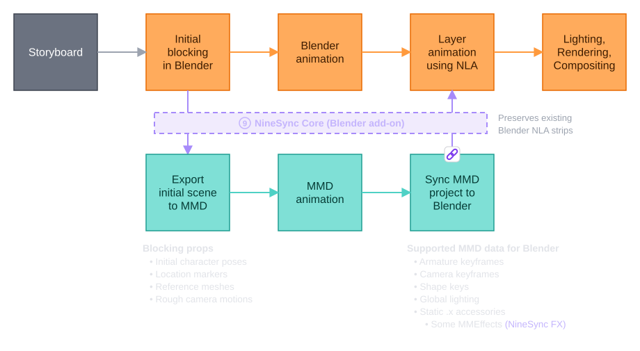

---
hide:
  - toc
---

# MMD and Blender Collaboration

Start with a project in MMD, bring it into Blender for lighting and rendering, then sync new animation as the MMD animator makes changes.

{ .no-lightbox }

## What you need

- NineSync with Core and FX, plus mmd_tools. See [Installation](../installation.md).
- An MMD project (`.pmm`) and the PMX models and accessories it uses. Keep those files in their original folders.

## 1. Bring the project into Blender

1. Open the **NineSync** tab and select the project under **Source PMM**.
2. Set a **Target** for each model you want to sync. If a model isn't in the Blender scene yet, import its PMX with mmd_tools.
3. Choose your sync options and click **Sync Now**. See [PMM Sync](../manual/core/pmm-sync/index.md).

<strong>Screenshot</strong>The NineSync panel after the first sync.

NineSync puts the imported motion in a **Motion** clip on its own NLA track.

## 2. Work in Blender

Set up the lighting, materials and render, add objects, or [animate with Rigify controls](rigify-vmd.md). Put any extra animation on your own NLA tracks above the synced clips so a later sync can update the imported keys independently.

## 3. Take MMD changes into Blender

When the MMD animator saves an updated PMM, click **Preview** to see what will change, then click **Sync Now**. NineSync updates the parts that changed and can also update models attached to a changed model. See [Checking for changes](../manual/core/pmm-sync/synchronization.md#checking-for-changes).

If you edited an imported clip directly, check [What happens to your edits](../manual/core/pmm-sync/synchronization.md#what-happens-to-your-edits) before syncing.

## 4. Send Blender work back to MMD

Use **PMM Create** to [export the scene to MMD](export-to-mmd.md). Keep the Blender scene for work that only Blender can store. See the [Compatibility Matrix](../manual/core/pmm-create/compatibility.md) for what carries over.
