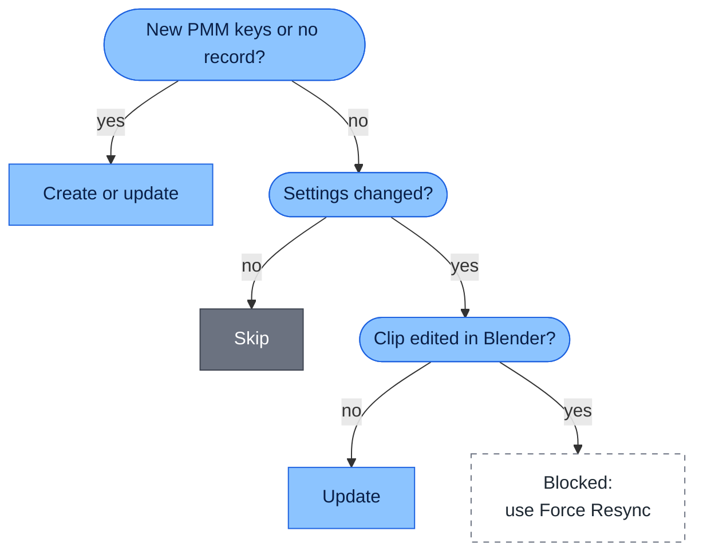

# Incremental Synchronization

A sync that re-imported everything every time would be simple, and it would destroy your work in Blender. Core avoids both by making two decisions before it changes anything: *which parts* of a project need updating, and *whether updating is safe* for the clips you may have edited. Both are made in one place, the plan (`build_plan` in `sync/plan.py`).

## Telling Core's output from your edits

What Core synchronized lives in ordinary actions and NLA strips, which you may edit, retime, mute or replace. After the next edit in MMD, Core has to answer two separate questions: *has the PMM changed?* and *has anyone changed what Core wrote?* Only when it knows both can it choose between leaving a clip alone, replacing it, and refusing to replace it.

Neither answer can be read from a file's modification time or an action's name. Saving a PMM again in MMD changes the file without changing the animation, and an action can be renamed or edited without Core noticing. Core therefore keeps, for each model and each part, a **record** of what it last produced, described by its *content*.

## Parts, fingerprints and the record

The unit of work is a **part**: one destination that is planned and imported on its own. A model has three, `motion` (the armature's bones), `shape` (the shape keys) and `visible` (mesh visibility), and the scene has two, `camera` and `light`.

The *source* of a part is described by two hashes. The **source fingerprint** hashes the parsed keys that feed the part. The **settings hash** covers everything else that shapes the output: the retime factor, the import scale, the target's name, the physics and Rigify options, and a signature of the rig's bone names (for motion) or of the resolved morph names and group morphs (for shapes). The *output* is described by the **output digest**, a hash of the F-curves of the action Core wrote.

The **record** ties these together. For each part it stores the last source fingerprint and settings hash, the key count, the frame range, a digest per track and the output digests of the actions written. It lives on the model's row (`sync_record`), so it is saved, undone and copied with the `.blend` and cannot leak into another file. A record belongs to one PMM, stored as a hash of its path rather than the path itself, and to one target name; a different file or target discards it, and the model counts as never synced. Records written under an earlier format are migrated in place (`upgrade_settings`) when they still match under the previous rule, so an update of the add-on does not force a re-import.

The camera and light have records of the same shape on the scene settings (`scene_record`), one per scene part and tied to the same PMM. There is no record for the whole project and no transaction: each model part and each scene part advances, or is cleared, on its own.

## Source fingerprints

`digest_tracks` hashes the *parsed* tracks: for each track its name, its key count and the packed bytes of every key (frame, location, rotation and interpolation for a bone key). Hashing parsed values rather than the file's bytes is the point of the design. Saving the PMM again, or changing a section the part does not use, leaves the fingerprint alone, while every field that reaches the action is part of it.

Some data is folded into the motion fingerprint because it changes the motion even though it is not a bone key. The IK switch keys count, but only when some IK is ever switched off, the one case that differs from a plain rig. The outside-parent bindings count, together with the names of the targets they point at, so that assigning a different parent model re-runs the motion. The weights and offsets of animated bone morphs count too. Each is added only when it exists, so the fingerprints of projects without these features are unchanged by them.

Alongside the hash of the whole part, `fingerprint_and_digests` keeps a short digest of eight hex digits for each track. These decide nothing; they let Preview name *which* bones and morphs changed.

### Outside parents: a source outside the model

With **Sync Model Constraints** on, the motion fingerprint of a bound model also covers the *other models its outside parents point at*. For each model that one of its bones is bound to, it includes that model's bone fingerprint and IK fingerprint (`outside_parent_motion`). A bound bone's solved keys depend on where its parent is, so a prop whose own keys did not change must still be solved again when the hand it rides on moves.

- **Only direct references count.** Edits to a model the parent is itself bound to, to the parent's morphs, or to anything other than the parent's bone and IK keys are not in the hash. Core does not follow dependencies further.
- **The change may name no bone of the model.** It is recorded as the *Outside parents* entry, so Preview lists that entry, and the list of changed bones can be empty although the model will update.
- **The work is shared within a plan.** The planner computes each model's bone hash and track digests once (the `memo`), so a parent and every model bound to it read the same value. Preview's list of changed tracks still describes one model's own tracks only.
- **State outside the PMM is not covered.** An edit to the parent's rig in Blender, a changed rest pose, or any other change to the *evaluated* pose that is not a PMM key of that parent goes undetected here.

An update caused by a parent counts as a source change in the decision below, so it follows the same rules as any other: if the bound model's clip was edited in Blender, the keys inside its PMM span are replaced and a warning names the clip. It does not bypass those rules, and it does not need Force Resync.

### Fingerprints do not set the order

The fingerprint says *whether* a model needs to run, not *when*. The order is a separate rule (`outside_parent_order`). A model whose bones are *solved* against another model is visited after that model, so that the solve reads the parent's new motion. A binding that becomes a live constraint on a parentless bone adds no order, because a constraint follows its parent whenever the parent syncs, and independent models keep their PMM order. Two models whose solved bindings point at each other cannot both be satisfied in one pass; the cycle is broken at the model that comes first in PMM order, which then syncs last.

## Output digests and edit detection

`action_digest` hashes an action's F-curves: each curve's path and index, and for every key its position, both handles and its interpolation. The result is compared with the digest saved after the last sync, and a difference means that you, or something else, changed the action. The comparison (`compare_outputs`) gives one of four states:

| State | Meaning |
|---|---|
| `ok` | the saved outputs still stand |
| `missing` | the action is gone, or no longer plays on its owner (strip removed, action unassigned) |
| `switched` | another action was selected in the clip field |
| `edited` | same action, different content |

An output digest is expensive, so a sync computes it only where the answer changes what runs: when the settings changed and the PMM did not. Preview checks every clip, so it can name an edited clip that an unchanged sync would not mention.

### The decision

The fingerprints and the output state decide what each part does. The rule behind the chart is that an edit made in Blender is never replaced because of a settings or version change alone; only new PMM keys or an explicit Force Resync allow it. The user-facing summary is in [What happens to your edits](../synchronization.md#what-happens-to-your-edits).

**Force Resync and the solve cache are separate decisions.** Force Resync decides that the motion is imported again. Whether the outside-parent *solve* is computed again is decided later, by the [solve cache](ik-morphs-parents.md#session-solve-cache): a forced import whose solve inputs are verified identical reuses the solve, and only a miss pays for the full evaluation.

### Example: a parent key changed inside a bound span

A sword model is bound to the right-hand bone of a dancer from frame 100 to frame 400. The animator moves one hand key at frame 250 in MMD and saves. The sword's own keys and bindings are unchanged, but the dancer's bone fingerprint changed, so the sword's *Outside parents* entry changes and its motion is planned as an update, after the dancer. All of the sword's solved span, frames 100 to 400, is solved again, not only the frames near 250. This is the correct result for a small edit: the hand's pose at frame 250 changes the interpolation towards both neighbouring keys, and Core does not solve part of a bound span. Keys you placed outside the sword's PMM span are restored as usual.

## Keeping what you added

Before an import replaces a clip, `snapshot_outside` records your keys that lie outside the model's PMM span, on every curve of the affected owners, and `restore_points` puts them back afterwards. The span runs from the first to the last key frame of the model, counting bones, morphs and IK switches, so keys before the first or after the last PMM key survive. Keys *inside* the span do not, by design, because they are what the PMM supplies.

The clip itself is placed by `place_clip`. The importer leaves a fresh action active on the rig. If the part already has a clip, the new content replaces it through `user_remap`, which points every user of the old action (strips, the clip field and other references) at the new one before the old action is removed; this is why an NLA strip or a reference to the clip survives a resync. Otherwise the action becomes a new clip, named after the model, on its own NLA track with an `MMDBridge` prefix, and your previously active action is restored if NineSync did not make it. Core only touches tracks and actions it owns (`is_bridge_action` and the track names it created), so layers you add on other NLA tracks above the clips play over the synchronized motion untouched.

## Failure and the record

A record advances only after its part imported successfully (`write_parts`). When a part fails, `forget_parts` removes its record, because a half-replaced action may no longer match any digest, and the next sync treats the part as never synchronized. Parts that were not attempted keep their records. A failed camera or light import clears that scene part's record alone, since it may have half-rebuilt its rig.

Planning costs a hash of each part's keys and, when needed, of the saved output curves. A part that is skipped avoids the far more expensive import and post-processing stages.

## Limitations

The behaviour above rests on three conditions. The record must be intact: a record that cannot be read counts as no record, which costs a full import but never causes a wrong skip. Your edit must be detectable: an edit that restores exactly the keys Core wrote cannot be told from no edit, and neither can an edit outside the curves the digest covers. And every setting that shapes the output must be in the settings hash: a setting that is not hashed would not trigger an update, which is why Core adds fields as features are added (`IMPORT_FORMAT`). The outside-parent coverage is the direct one described above: it does not follow chains of parents, and it does not see changes made in Blender.
