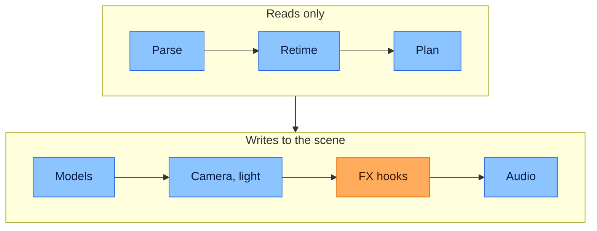
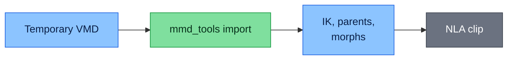

# How PMM Sync Works

These pages explain how Core synchronizes a PMM with a Blender scene, why it is built the way it is, and where its guarantees end. They assume you have used [PMM Sync](../index.md) and want to know what happens underneath.

## Why synchronizing is more than converting keyframes

An MMD project and a Blender scene describe animation differently. A **PMM** stores bone and morph keys, display states, camera and light tracks, accessories and audio. It refers to the parts of a model by their position in the PMX bone and morph lists. The final pose is computed only during playback, and it includes IK, append transforms, bone morphs, outside-parent bindings and physics.

Blender stores the *result* of animation: F-curves on named channels, grouped into actions, layered with NLA tracks and combined with constraints and drivers. Its axes differ from MMD's (Y and Z are exchanged), its units differ, its frame rate is a scene setting, and its IK solver is a different algorithm.

Copying keys from one to the other therefore falls short in four ways.

1. **Some of what MMD plays is computed, not stored.** IK, bone morphs and outside parents have no F-curve counterpart. A rig that only receives the keys bends its legs differently, and props bound to it do not follow.
2. **Names and indices must be reconciled.** A VMD, the format Blender's importers understand, carries bone names of at most 15 bytes. A PMM refers to bones by index. The Blender rig carries whatever names the PMX import produced.
3. **A sync is repeated.** You keep working in Blender between syncs, so the converter has to tell its own earlier output from your edits, and it should not redo work that has not changed.
4. **The scene's frame rate can differ from MMD's.** Keys must be rescaled in time without turning cuts into blends.

Each of these shapes the design. Core parses the PMM into an intermediate representation that is never modified ([parsing](parsing.md)). It hands the bone and morph keys that mmd_tools already converts to mmd_tools, rather than reimplementing that conversion, and adds what mmd_tools does not provide ([animation conversion](animation-conversion.md); [IK, bone morphs and outside parents](ik-morphs-parents.md)). It records fingerprints of what it produced, so that the next sync can decide what to redo ([incremental synchronization](incremental-sync.md)). Accessories are passed to FX through a hook ([accessory and FX integration](accessory-fx-integration.md)). How these parts fit around mmd_tools and FX is shown in [How the parts fit together](../../../index.md#how-the-parts-fit-together).

## The pipeline

One sync is a single ordered path. Each stage starts after the one before it has finished, and nothing in it runs in parallel. The order is fixed in `sync_steps` in `sync/engine.py`.

The model stage repeats for each model that the plan says has work to do. The model is the unit of work, but its three parts (`motion`, `shape` and `visible`) are planned separately, so a model may run only one of them. Models are visited in PMM order, with one exception: a model whose bones are *solved* against another model's pose ([outside parents](ik-morphs-parents.md#outside-parents)) is visited after that model, so that the solve reads the parent's new motion.

The camera, light and audio never go through this path. They are applied by `import_scene_elements` and `import_audio`, each with a record of its own.

## Errors, cancellation and undo

A failure is contained at the smallest unit that can be recovered, and each rule follows from what has already been written when the failure occurs. Three mechanisms are easy to confuse here, and they are separate: partial data, cancellation and undo.

**Partial project data.** A failure in the model section aborts the read. A failure in a later section is recorded for that section alone, and the sections before it are kept ([failure behaviour](parsing.md#failure-behaviour)).

**Failed models and parts.** Each model is imported inside its own guard in `sync_target`. A model that fails is marked in its row, its record for the failed parts is cleared so that the next sync retries them ([the record](incremental-sync.md#failure-and-the-record)), and the other models continue. The post-passes (outside parents, leg IK and bone morphs) each run in a guard of their own after the importer, so a failure there is logged and the plain import stays in place.

**Hook failures.** The accessory and effect hooks run after the models and are counted apart from them (`run.hook_failed`). A hook that raises is logged and does not stop the next hook or the audio step. The status line reports "accessory/effect item(s) failed" separately from "model(s) failed" ([cancellation and failure](accessory-fx-integration.md#cancellation-and-failure)).

**Cancellation.** Pressing **Esc** sets a flag that Core honours at its next yield. A yield is a boundary between units of work: between models and, when a hook yields, between that hook's accessories or effect passes. It never falls inside a model's own import, so a cancelled sync leaves each model either fully synced or untouched. The price is that a single long step, such as one model's import or one effect build, cannot be interrupted, and Esc can take as long as that step to be heard. A cancelled sync skips the remaining models, the camera and light, the hooks and the audio.

**Undo.** The whole sync is a single undo step, including a cancelled or failed one. Work done before a cancel belongs to that step: **Esc stops further work but keeps what has been done**, and Ctrl+Z removes all of it. Cancelling is therefore not an undo. A partial import is a valid state that the next sync continues from, because each completed model already has its record.

These guarantees concern Core's own bookkeeping. If Blender or mmd_tools raises inside the importer, the model is reported as failed and its parts are planned again on the next sync.

### The timing summary

Every sync, including a failed or cancelled one, ends with one line in the `NineSyncLog` text block: `timing summary status=... total_ms=...`. It gives wall-clock totals for the phases (read, parse, retime, plan, per-model phases such as `vmd_build`, `importer`, `outside_parent_eval` and `outside_parent_write`, camera and light, hooks and audio) and work counters: the models synced, unchanged, blocked and failed, the source keys, and for the outside-parent solver the frame changes (`outside_parent_frame_sets`), the keys written and added, and the solve-cache hits, misses and rejections ([the solve cache](ik-morphs-parents.md#session-solve-cache)).

The line is written to the log only. It is not the progress text the panel shows during a sync, and Preview, which runs no phases, writes none.

## Pages in this section

- [PMM Parsing and Serialization](parsing.md): the binary layout, key chains and the writer.
- [Animation Conversion](animation-conversion.md): identity, scale, frame rate, interpolation, morphs, camera, light, visibility and audio.
- [Incremental Synchronization](incremental-sync.md): fingerprints, the sync record, clips and how your edits are preserved.
- [IK, Bone Morphs and Outside Parents](ik-morphs-parents.md): the parts of MMD's playback that are computed.
- [Accessory and FX Integration](accessory-fx-integration.md): the hook between Core and FX.
