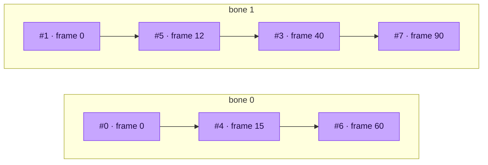

# PMM Parsing and Serialization

Core is the only component that reads a PMM. FX never opens one; it receives the parsed project from Core through a hook ([Accessory and FX Integration](accessory-fx-integration.md)). The parser lives in `pmm.py` and the writer in `pmm_writer.py`.

## A format known only through its files

A PMM is MikuMikuDance's own save file. It has no public description and was never meant for exchange; the layout Core uses was recovered from files saved by MMD. Three properties of the format shape the parser.

First, the file is strictly sequential. It is a run of variable-length records, counts and length-prefixed Shift-JIS strings, with fixed-size state blocks between the sections, and it has no table of offsets. The position of every section therefore depends on the exact size of everything before it, and a mistake in one record misaligns all that follows.

Second, the animation is stored as linked records, not arrays. MMD stores one initial key for each bone and chains the further keys to it through `next` indices, so the order of the records in the file is not the order of the frames. The chain order is what MMD plays.

Third, much of the file is editor state, such as selected bones, panel choices and timeline row flags, and its meaning is only partly known. A reader can ignore it. A *writer* cannot invent it, and getting it wrong makes MMD reject the project.

## Reading

Every read goes through `Reader`, a cursor over the file's bytes. Each of its primitives (`u8`, `i32`, `unpack`, `raw`) first checks that enough bytes remain and raises `PmmError` otherwise, and counts are checked to be non-negative. A truncated or corrupt file thus fails with the exact byte offset instead of reading past the end of the buffer.

`parse_pmm` reads the sections in file order, skips the fixed-size state blocks, and returns a `PmmProject`. Other versions of the format are rejected, because different block sizes would misalign every section after the first difference.

**Fixed-size records.** The bone and morph sections are long arrays of fixed-size records: the initial record of each track and the additional records that continue it. Reading each record with its own `unpack` call dominated the parse of long motions, so `Reader.records` reads the whole block at once. It checks the block's bounds once (`need`, which raises the same `PmmError` on truncation as any other primitive) and walks it with `struct.Struct.iter_unpack` over a `memoryview`, without copying the bytes. Only the *cost* of the parse changes: the decoded records, their order and the behaviour on a truncated file are the same as with one read per record.

### Key chains

A *track* is the list of keys of one bone or morph. A bone's initial record gives its first key and the index of the next record, and `collect_bone_chain` follows those links through the pool of additional records. It stops when the index is `0`, when a record is missing, or when an index repeats, so that a damaged file cannot loop forever. `normalize_keys` then drops keys on negative frames, keeps the *last* key written for any frame, and sorts the keys by frame. The display track is walked the same way, because its chain order is also what MMD plays.

The file stores bone 1's further keys as #3, #5 and #7, but its chain plays them as #5, #3 and #7, which is frame order.

### The intermediate representation

The parse produces plain values that are never modified afterwards. Keys are `NamedTuple`s, and this matters later: `copy_project` can give a sync its own copy of the project in which every list is new but the keys are shared, so retiming the copy cannot alter the parse that was kept.

| Structure | Holds |
|---|---|
| `PmmProject` | models, camera keys, light keys, accessories, play range, audio, and an error string for each section that failed |
| `PmmModel` | name, PMX path, bone and morph name lists, `bones` and `morphs` (one key list per name), `visibility`, `ik_keys`, `outside_keys`, `constraints`, `outside_parents` |
| `BoneKey` | `frame`, `location`, `rotation` (quaternion, stored x y z w), `interpolation` (16 bytes) |
| `MorphKey` | `frame`, `weight` |
| `CameraKey` | `frame`, `distance`, `look_at`, `angle`, parent model and bone, `interpolation`, `perspective`, `fov` |
| `VisibilityKey`, `IkKey`, `OutsideKey` | the display track: shown flag, one on/off state per IK constraint, one `(model, bone)` per outside-parent slot |

**IK switches.** `PmmModel.constraints` lists the PMX bone index of each IK, and `IkKey.states[k]` is the switch for `constraints[k]`. MMD stores the IK switches and the outside parents in the same key as visibility, which is why the display track is separate from the bone tracks.

**Outside parents.** These use the same indirection. `PmmModel.outside_parents` lists the PMX bone index that owns each outside-parent *slot*, and each display key (an `OutsideKey`) holds one `(model, bone)` pair per slot, in slot order. `outside_parent_keys` turns this into one `(frame, state)` list per bone, where a state is one of three things:

| Stored pair | Meaning | `outside_parent_keys` gives |
|---|---|---|
| model `-1` | no outside parent: the bone keeps its own skeletal parent | `None` |
| model `-2` (`OUTSIDE_FREE`) | released from its parent into the model's own frame | `(OUTSIDE_FREE, 0)` |
| a model index and a bone index | bound to that bone of that model (the model may be the same one) | `(model, bone)` |

`link_outside_bones` then fills `PmmModel.outside_bones` with the *name* of each bound bone, so that later stages can look the parent up by name on the Blender rig. What Core does with each state is described in [IK, Bone Morphs and Outside Parents](ik-morphs-parents.md#outside-parents).

**A lone key at rest is not animation.** MMD stores one initial key per bone whether or not the animator touched it. `bone_track_moves` therefore treats a track as animated only if it has more than one key, or if its single key differs from the rest pose by more than `REST_EPSILON` (1e-6). This definition recurs throughout the sync: it decides which bones are reported, which are fingerprinted and, for Rigify, which are carried over.

### Interpolation bytes

Each bone key carries four curves, three for the location channels and one shared by the rotation, each as four bytes `x1 y1 x2 y2`. The bytes are *signed*: a stored 211 means `-45`, not 127. The difference is easy to miss and large in effect. For that value MMD places a bone 2.5 % of the way between two keys, while reading 211 as 127 would place it at 62 %. `curve_values` therefore reads signed values and clamps the `x` values to 0–127, so that time stays inside the key's span, but lets the `y` values over- and undershoot, which is how MMD produces anticipation and follow-through. `interpolation_to_vmd` rearranges the 16 bytes into the VMD's 64-byte row of four shifted copies, and caches the result by input, because a file holds only a few distinct curves.

## Failure behaviour

The staged `try` blocks in `parse_pmm` decide what survives a damaged file. A failure while reading the models is fatal. A failure in the camera or light section stores `scene_error` and leaves the models usable; one in the accessory section stores `accessory_error` and an empty accessory list; one in the audio section stores `audio_error`. Because each section is positioned by the ones before it, a failure cannot be skipped over: the sections after it are dropped, never guessed.

## Serialization

Creating a PMM raises the opposite problem. The writer must produce a file that MMD accepts, including the editor state it has no data for. Core therefore never builds a PMM from nothing: `build_pmm` starts from a **template** saved by MMD itself and replaces only what it has data for.

| Part | Source |
|---|---|
| Header, light, audio, global state | copied from the template unchanged |
| Models, bone and morph tracks, display track | written from the exported data |
| Per-model editor state | taken from the template model (`model.opaque`), except the draw order and compute order, which must be unique and 1-based |
| Per-bone and per-morph state shown on load | written from the key at frame 0, with no selection flag |
| Camera | written from the selected camera rig; its state block is set from the first key |
| Accessories | spliced into the section, which must be empty in the template |
| Play range | set in the 28-byte playback state |

The writer follows MMD's conventions as MMD saves them. Key indices share one sequence per track, every bone and morph gets a first key at frame 0, and names are cut at exactly 49 bytes (model) and 19 bytes (bone) of Shift-JIS, even inside a two-byte character. MMD compares these bytes with the PMX and refuses a project whose names do not match.

<!-- prettier-ignore -->
!!! note "What is exact and what is not understood"
    The key chains, the signed interpolation bytes and the byte limits are the layout of files saved by MMD 9.32, and the code applies them as exact rules. Some bytes are not understood: the playback state at offset +12 is written as `0`, which MMD 9.32 loads without complaint. Another MMD version may save another layout; the limits above are those of MMD 9.32.

### Reusing a parse

Preview keeps the project it last parsed, together with a short digest of the file's bytes (the first 12 hex digits of an MD5, the same value the sync log shows). When Sync Now reads a file with the same digest, `parsed_copy` hands it a *copy* of that project instead of parsing again. The copy is made before retiming, so retiming can never alter what Preview kept, and the kept parse is dropped when the sync ends.

Two other things are called "cached" and have nothing to do with this one. Preview's *result* is guarded by a cheap input token (file size and time, the target rows and the settings) that only decides whether the Preview on screen is stale. The outside-parent [solve cache](ik-morphs-parents.md#session-solve-cache) is keyed by the evaluated Blender scene, not by the PMM bytes, and lasts for the session.
