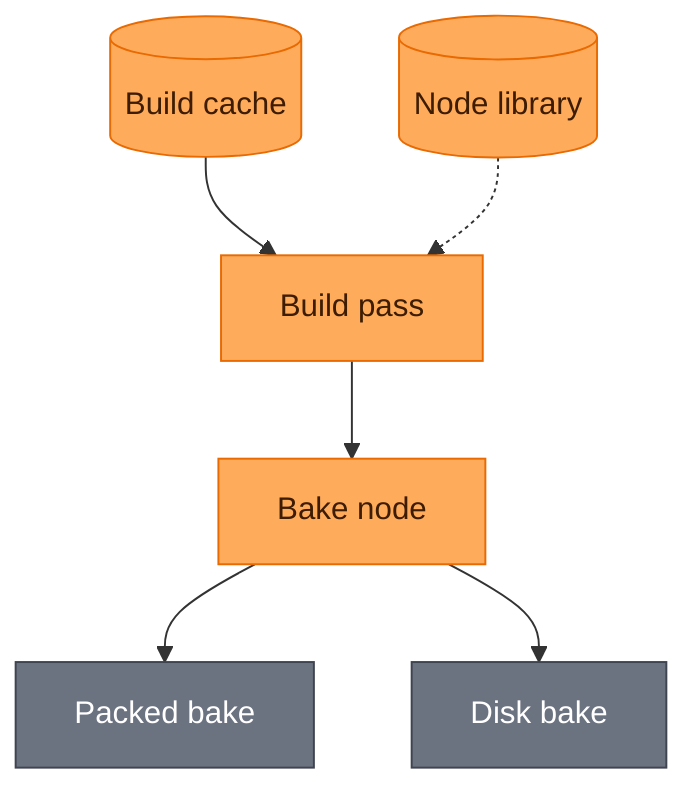

# Cache Architecture

An effect build repeats expensive work: parsing large `.x` files, probing shaders under many states and baking every frame. FX therefore stores results in several places. Each store answers a different question, lives in a different place, lasts for a different time and is cleared by a different button, so this page separates them first and then describes each one.

<!-- prettier-ignore -->
| | Answers | Lives in | Keyed by | Lifetime / limit | Cleared by |
|---|---|---|---|---|---|
| **Per-pass manifest and known-empty list** | "Is this pass already built for these inputs? Does this draw produce nothing?" | on the objects in the `.blend` (`mme_manifest` on each pass, `mme_empty_passes` on the root) | the [build signature](index.md#incremental-rebuilds) | with the project | rebuilding or removing the effect |
| **Build cache (on disk)** | "What does this `.x` contain? Which vertices or rows can I skip? Which alpha gates and empty-at-Tr=0 proofs hold?" | the `cache` folder | the **content** of the inputs | **Cache Limit** | **Clear Effect Caches** |
| **Strip sample cache** | "What did this probe state's vertex shader output last time?" | memory, this session | the pass inputs and the exact values of the globals actually read | byte budget set by **Build Memory** | file load, accessory cleanup |
| **Project-local bakes** | "What does *this project* show?" | in the `.blend` (packed) or in your **Bake Folder** | the pass object | none | **Clear All** (bakes), **Clean Accessories** |
| **Shared bake store** | "Has this exact effect and animation been baked before?" | `cache/bakes/<address>/` | the portable bake signature | **Shared Bake Limit** | **Clear Shared Bakes** |
| **Shared node library** | "Which standard node groups already exist?" | `mme_core.blend` in the user folder | group keys and a library version | persistent; separate from every cache above | not part of any clear button ([Shared Node Library](shared-library.md)) |

## The build cache

**Where.** A folder named `cache` beside your node library (the user folder of the add-on), or the folder you choose in
the add-on preferences (**Cache Folder**). Standalone FX and the bundled add-on can share one folder ([Add-on Preferences](../geometry-nodes/index.md#add-on-preferences)); their keys are compatible. Without a user folder, the system temp folder (`ninesync_cache`) is used. That temp folder is also where older versions kept the cache, and **Clear Effect Caches** empties it too.

| File                          | Contents                                                                                  | Used for                                 |
| ----------------------------- | ----------------------------------------------------------------------------------------- | ---------------------------------------- |
| `x_<digest>.npz`              | the `.x` file parsed into numpy arrays                                                    | skipping `.x` parsing                    |
| `precull_<digest>.npz`        | for each probed condition, which vertices are kept and which gates open                   | skipping [pre-cull](culling.md#pre-cull) |
| `precull_<digest>_strip.json` | the rows kept by [strip simplification](culling.md#strip-simplification), per run of rows | skipping strip analysis                  |
| `gates_<md5>.json`            | the result of the [alpha-gate search](culling.md#alpha-gates) for a pass                  | skipping the gate search                 |
| `empty_<md5>.json`            | the result of the [empty-at-Tr=0 probe](culling.md#empty-at-tr-0) for a pass              | skipping the Tr = 0 probe                |

**What it is for.** Pre-cull can dominate the first build, so its results are cached for subsequent builds. The [measured run](culling.md#a-real-run-beammans-thunder-lv2) illustrates the geometry being analysed.

### How keys are built

Keys are MD5 hashes of the _content_ that determines the result, so a file renamed or copied elsewhere hits the same
entry:

- **`.x` file:** `md5(content digest of the .x | MME_CORE_VERSION)`.
- **Pre-cull file:** `md5` over `MME_PRECULL_VERSION`, the Blender version, the digests of the `.fx` files, the digest of
  the `.x`, the digest of the textures, the technique, pass, subset and draw order, the count and sum of the used
  vertices, the alpha gates and extra loop information.
- **Strip entry** (inside the strip file): `md5` over `MME_STRIP_CACHE_VERSION`, the probe-condition signature, the camera
  matrices, the tolerance, loop instances, density and the first and last row.

- **Alpha gates and the Tr = 0 proof** (`gates_*`, `empty_*`): `md5` over `MME_GATE_VERSION`, the Blender and numpy versions, the digests of the `.fx` files, `.x` and textures, the pass identity, the vertex-shader output layout, the opacity globals, the instance count, the probe constants and the probe state's exact bits (the Tr = 0 proof also holds a digest of the pass's source vertices and the density).

**Versioning and invalidation.** Each kind carries a version in its key, so changing the algorithm changes the key and old entries are simply never read again (and are removed by the size limit in time): `MME_CORE_VERSION` for the `.x` data, `MME_PRECULL_VERSION`, `MME_STRIP_CACHE_VERSION` and `MME_GATE_VERSION`. A cache file that cannot be read is treated as missing. Entries are never edited in place; a changed input makes a new key.

<!-- prettier-ignore -->
!!! example "Measured: a renamed copy"
    Beamman's Thunder was built cold (49.8 s), built again (3.4 s), then copied to another folder under a new name and built
    again: **3.5 s**, with the log line `57 of 57 visibility states known` and an unchanged number of cache files. The
    cache did not care about the name or the folder.

### Size and eviction

- The limit is **Cache Limit (MB)** in [preferences](../geometry-nodes/index.md#add-on-preferences).
- Files are removed **least recently used first**, by modification time. A cache hit _touches_ the file, so something you
  keep using stays.
- Writes are **atomic**: written to a temporary file and moved into place (`os.replace`), so a crash cannot leave a
  half-written cache file that is later trusted.
- After one Beamman's Thunder effect, the cache folder was about **7.3 MB**: a 7.27 MB `x_*.npz` and small `precull_*` files.

**Pre-cull Cache** (in settings) turns the on-disk pre-cull and strip entries off. It does not affect baking.

## The strip sample cache

Strip simplification first *samples* the vertex shader under a set of probe states, and then scores rows from those samples. The sampling is the expensive part, so its results are kept in memory (`runtime/sample_cache.py`) and can be replayed by a later build in the same session, for example when a rebuild changes only the tolerance or a keyed opacity variant.

- **Pass key.** Covers the effect files and textures, the technique, pass, subset and draw order, the loops, density, instance count and batch shape, and the *exact bytes* of the source vertex inputs the rows use.
- **State key.** Within a pass, an entry is found by the exact values of the globals the evaluation **actually read**, not all globals, so a state that differs only in a global the shader never touched still hits.
- **Replay.** A hit replays the same arrays in the same batches, so the samples are the same bits as a fresh evaluation, and the same row search runs on them.
- **Deduplication.** Per-instance results are stored once however many probe states or builds produced them. Two instances are merged only after their bits are compared exactly.
- **Budget and eviction.** Entries are evicted least recently used first to stay within the byte budget of **Build Memory** ([budgets](culling.md#effect-density-and-build-memory)).
- **Lifetime.** The cache is emptied on file load (`mme_load_handler`) and by accessory cleanup. Nothing is written to disk and nothing outlives the session.

These budgets are in memory and separate from the on-disk limits.

## Shared bake store

A bake can take a long time and big disk space. Often the same effect with the same animation is baked in many
projects (a stage you reuse, a render you restart). With **Store: Disk** and **Share Bakes** on, FX keeps the bake in a
shared folder named by an **address**: a hash of everything that determines the baked frames.

`cache/bakes/<address>/`

| Entry                     | Meaning                                                   |
| ------------------------- | --------------------------------------------------------- |
| `meta/<frame>_.json` | one record per baked frame, written by Blender            |
| frame data                | the baked geometry for the frames                         |
| `complete.json`           | written _last_: `{v, key, frames: [start, end], created}` |

### The bake signature

Whether a recorded bake is still valid is decided by a **bake signature** (`mme_bake_inputs` in `runtime/manifest.py`) built from what the managed Bake node's output depends on. It follows dependencies; it does not just hash a few properties:

- **Build identity:** the pass's [build signature](index.md#incremental-rebuilds), so a changed effect file, parameter, density or backend changes the bake.
- **Frame range and FPS**, the **bake target** and, for a disk bake, the layout (shared, per-pass folders, or one folder).
- **The geometry reaching the Bake node:** a digest of the node tree that holds it (nested groups by content; names, labels and positions are left out so tidying does not count), plus the identifiers of the modifier inputs that *reach* the Bake node. An input that only feeds nodes after the Bake node never changes the bake.
- **Reachable modifier inputs** that are not driven, by value.
- **Drivers:** each driver's expression and the exact sources of its variables, with their animation.
- **Objects the pass depends on:** the transform chain (parents), constraints, armature and bone dependencies, action slots and NLA, followed through a **bounded depth** (`MME_DEPENDENCY_DEPTH`).
- **Camera or light**, when the pass reads them: always for a Python-backend pass or one with uniforms set by the frame handler, and for a Geometry Nodes pass that reads the active camera.

A dependency that cannot be read or traversed completely (too deep, an unsupported type) is recorded as **unverifiable**. A signature with unverifiable parts never matches, so such a bake is never trusted as reusable and is never shared. This is also how **Core can change a bake with unchanged FX files**: the signature includes the animation of the rigs, bones and lights the effect reads, which Core writes. After a sync that edits that animation, FX rechecks the bakes it touched and a bake whose signature no longer matches goes stale or is cleared (the seam tests in `tests/t_seams.py` cover this).

### What goes into the shared address

The **portable bake address** (`mme_portable_bake_sig`) is that same signature, made _portable_ by **leaving out** the bake directory, layout, target, and the **object and root names**, and **adding** the Blender version, `MME_CORE_VERSION` and the store version (`MME_BAKE_STORE_VERSION = 1`). Leaving out names is why two projects with differently named objects but the same effect and animation get the same address. Adding the versions is why a Blender or FX upgrade that could change the result does not reuse an old bake. A signature that is unverifiable has no address and is never shared.

### Graph-only staleness

Editing the pass's nodes should not throw away a bake you are still comparing against. The check is therefore **scoped upstream of the managed Bake node**:

- A change to *only* the graph digest marks the pass **stale** (`graph_only`), but **the previous bake stays attached** and is what plays and renders.
- Other detected input changes (an effect parameter, the animation it reads, the frame range) **clear the bake** so the pass evaluates live until rebaked, because showing an obsolete bake would be wrong.
- **Bake Changed** rebakes the stale passes, which records the edits upstream of the Bake node. Live mode is suspended while the bake is captured (a bake only records while the Bake node is evaluated) and restored afterwards.

### Which "is it still baked?" answer you are getting

Three different answers are distinguished (`mme_bake_decision`, `mme_bake_storage`):

1. **Signature match.** The recorded signature equals the current one.
2. **On-disk validation.** For a disk bake, FX then checks the stored frames **frame by frame** in the pass's own folder. Blender 5.3 reports a finished bake even when it could not resolve the folder and fell back to packed storage, so the status flag alone is not trusted.
3. **Packed fallback.** For a packed bake this Blender version exposes nothing to ask, so FX trusts the recorded state and says so in the log ("packed bake not queryable through the API; recorded state trusted").

### Publishing without half-finished bakes

1. A bake writes into a private folder `_tmp_<address>_<pid>_<random>`.
2. When it finishes, `complete.json` is written inside it.
3. The folder is **renamed** to `<address>`. If another process published the same address first, that copy is kept and
   this one is discarded.
4. A reader only trusts a folder that has `complete.json`, with the right version and frame range, and with a record for
   **every** frame in the range. A pass looks up its portable address *before* baking and attaches a complete entry frame by frame; a partial one is not attached.

An interrupted bake or one made by another Blender never looks finished. `_tmp_` folders older than **24 hours** are
swept.

### Size and eviction

- **Shared Bake Limit (MB)** in [preferences](../geometry-nodes/index.md#add-on-preferences).
- A bake batch (one operator run over many passes) trims the store **once, when it ends**, not after every publish, and the trim never evicts a bake that batch published or attached, because a pass of this project is using it. The store deletes the **least recently used** bakes (by `complete.json` modification time, touched on every hit) until it fits, and sweeps temporary folders of interrupted bakes.
- A project that still points at a deleted bake finds frames missing and **rebakes**.

<!-- prettier-ignore -->
!!! warning "Clear All does not delete shared bakes"
    **Clear All** removes bakes from the project. For a pass that is using a bake that lives in the _shared_ store, it
    **unlinks** the pass from it (`mme_clear_bake`) and does not delete the shared files, because other projects may be
    using them. To delete shared bakes, use **Clear Shared Bakes**.

## Project-local bakes

| Store                 | Where it is                                 | Notes                                                                                                                                                             |
| --------------------- | ------------------------------------------- | ----------------------------------------------------------------------------------------------------------------------------------------------------------------- |
| **Packed in .blend**  | inside the file                             | grows the file; nothing else to manage                                                                                                                            |
| **Disk** (not shared) | the **Bake Folder** (default `//mme_bake/`) | with **Folder per Pass**, each pass gets its own folder (below) |

The per-pass folder name uses the **pass key**, which already encodes the effect instance, technique, pass, subset and
order, and does not change when you rename an object. Blender only resolves `{blend_name}` in a bake directory
(object, modifier and scene names make it fall back to a packed bake), so the pass part is written literally.

**Bake Changed** compares each pass's recorded bake signature with its current inputs and rebakes only those that differ.
**Force Rebake All** ignores it.

<!-- prettier-ignore -->
!!! tip "Which one should I use?"
    - Working on one project: **Packed**, or **Disk** with the default folder.
    - Rendering the same effect in several projects, or on several machines pointing at a network cache folder: **Disk + Share Bakes**.
    - Sending a project to someone: **Packed**, or **Disk** with **Share Bakes** off and the bake folder next to the `.blend`.

## What clears what

| Action                     | Build cache  | Shared bakes     | Project bakes                               |
| -------------------------- | ------------ | ---------------- | ------------------------------------------- |
| **Clear Effect Caches**    | yes          | no               | no                                          |
| **Clear Shared Bakes**     | no           | yes              | no (passes will rebake if they point there) |
| **Clear All** (Bake panel) | no           | no, only unlinks | yes                                         |
| Cache limit reached        | oldest files | no               | no                                          |
| Shared limit reached       | no           | oldest bakes     | no                                          |

The table above covers the three clear buttons. **Clear Effect Caches** removes every file in the cache folder and in the legacy temp folder (`ninesync_cache`); it does not touch the in-memory strip sample cache or the node library `mme_core.blend`.

## Related pages

- Source: [`runtime/cache_store.py`](https://github.com/sen-trie/nine-sync-fx/blob/master/runtime/cache_store.py),
  [`runtime/bake_store.py`](https://github.com/sen-trie/nine-sync-fx/blob/master/runtime/bake_store.py),
  [`runtime/bake_paths.py`](https://github.com/sen-trie/nine-sync-fx/blob/master/runtime/bake_paths.py),
  [`runtime/precull.py`](https://github.com/sen-trie/nine-sync-fx/blob/master/runtime/precull.py)
