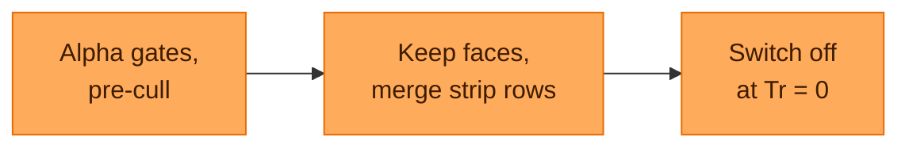

# Culling and Geometry Optimization

Many MME accessories are built far larger than what they ever show. Beamman's Thunder lv2, the effect used throughout this manual, has meshes of 20,000 to 30,000 faces per pass, copied 28 or 64 times, to draw a few bolts of lightning. Building all of it would produce tens of millions of vertices.

So **before** FX builds any node, it probes each pass and removes the geometry that is never needed in the states it samples. This page explains how that is decided, what it costs, and when the result can be trusted.

<!-- prettier-ignore -->
!!! info "Order matters"
    Culling runs _before_ the Geometry Nodes tree is generated ([the pipeline](index.md#the-pipeline)). The nodes you see in Blender operate on the mesh that is already reduced; culling is not a node you can toggle.

## The stages

For each pass, `mme_build_pass` (in `runtime/build_pass.py`) makes five decisions in order. Each has different inputs, and each is conservative in its own way.



<!-- prettier-ignore -->
| Stage | Question it answers | Code | Where work is skipped |
|---|---|---|---|
| **Alpha gates** | Does the pixel shader make a pixel invisible when some vertex output is ≈ 0? | `mme_alpha_gates` | a finished search is read back from the disk cache |
| **Pre-cull** | For which vertices does the vertex shader ever put the vertex on screen, or open a gate, under realistic conditions? | `mme_prune_mask` | probe states already known in the pre-cull file are not evaluated again |
| **Face decisions** | Keep only faces that touch a kept vertex (and an open one, when there are gates), then add a margin | `mme_keep_faces`, `mme_grow_faces` | no evaluation; works on the masks above |
| **Strip simplification** | Merge rows of ribbons and rings that the shader could recreate by interpolation | `mme_simplify_strip` | exact sample replay and stored row choices ([below](#how-the-analysis-is-evaluated)) |
| **Empty at Tr = 0** | Can the pass be switched off completely when opacity is 0? | `mme_empty_at_zero_tr` | the proof is read back from the disk cache |

Two later optimizations are **not** culling rules and are described elsewhere: the [per-particle shader stage and the transparency order](geometry-nodes-translation.md#loops-and-instances) change *how* the kept geometry is evaluated, not which geometry is kept.

The build log reports the result for each pass in one line:

```text
effect pass <label>: <kept> of <before> faces kept (<n> never drawn, <n> always transparent via <semantic>.<component>, <n> merged along strips) in <t>s (alpha gates …, pre-cull …, strips …)
```

### Alpha gates

A **gate** is a vertex-shader output, for example the `x` of a `TEXCOORD`, that the pixel shader multiplies into its alpha. If forcing it to almost zero makes the pixel shader return alpha ≈ 0 for every random probe, while the unmodified values are visible somewhere, FX treats it as a gate. Vertices whose gate is _closed_ never show.

The test (`mme_alpha_gates` in `runtime/pruning.py`) works as follows.

- The pixel shader is run in numpy on **96 random probes** (`MME_GATE_PROBES`), with one component forced to `1e-5` (`MME_GATE_EPS`). "Invisible" means alpha ≤ `1/512` (`MME_GATE_ALPHA`).
- The test counts only under a blend state in which alpha 0 really draws nothing (`mme_alpha_scaled`): source-alpha blending, added with ONE or inverse source alpha. For opaque or multiply passes alpha 0 proves nothing, and no gate is used.
- If the test fails or cannot be evaluated, the result is "no gates". The random probes do not cover every possible input.
- The probes use fixed seeds, so the search is deterministic, and a finished search is cached on disk. Its key holds the contents of the effect, the `.x` and the textures, the pass, the exact bits of the probe state, the output layout, the opacity globals, the instance count and the gate constants, plus the Blender and numpy versions (`MME_GATE_VERSION` invalidates older searches). A failed search is not cached.

Values that are not finite are treated conservatively: a `NaN` alpha counts as opaque, so it can only keep geometry, and a discarded pixel counts as alpha zero.

### Pre-cull

The vertex shader is run in numpy for **every vertex** of the pass, and for every loop copy, under a set of probe conditions, and FX records which vertices ever land inside the view or open a gate:

- opacity (**Tr**) samples of `1.0, 0.8, 0.6, 0.4, 0.2, 0.0` (`MME_PRUNE_TR`);
- the parameter extremes and the keyed variants of the effect, that is, parameters or controllers that are animated in the PMM.

A vertex that never shows in any of those states is dropped, together with the faces that touch only dropped vertices. This is the expensive stage. Its result is cached on disk, so a re-import, a copy of the effect or a rebuild with unchanged inputs skips it ([Cache Architecture](cache.md)).

<!-- prettier-ignore -->
!!! warning "Culling is based on sampled states"
    Pre-cull evaluates the shader under a finite set of states (the Tr samples, parameter extremes and keyed variants above), not under every possible state. An effect driven in a way those samples do not cover could lose geometry that MMD would show, and FX does not try to detect that case ([When something is missing](#when-something-is-missing)).

### Prune faces and grow the margin

Faces are kept when they touch a kept vertex. When gates are in use, the face must touch both a kept vertex and an
_open_ one, and then a **margin of 2 rings** of neighbouring faces is added (`MME_GATE_MARGIN`). The margin exists
because a gate is judged per vertex but the pixel shader interpolates it across the face, so a gate that opens in the
middle of a face would otherwise be cut.

### Strip simplification

Beams, trails and rings in MME effects are usually **strips**: a ladder of rows of vertices, each row the same width,
with faces only between neighbouring rows. Beamman's Thunder's rings use thousands of rows to make a smooth curve. When the vertex
shader's output between two rows is almost a straight interpolation of their neighbours, the middle rows add nothing.

FX detects the layout (`mme_strip_layout`: UV rows form a ladder, at least 16 vertices, at least 8 distinct rows, faces
only between adjacent rows) and then **recursively splits** each span at the row that interpolates worst, until every
remaining row interpolates within the tolerance (`mme_simplify_prepared`):

- the error is measured on **positions and on every vertex-shader output that varies** (UVs, alpha, colour), not on
  positions alone, over all the probe runs (Tr samples `1.0, 0.9, 0.75, 0.6, 0.45, 0.3, 0.15, 0.0`, parameter extremes
  and up to 8 keyed variants);
- the tolerance is relative to the effect's size. The **Geometry Tolerance** setting is the share; the default is
  **0.0005** (0.05 %), the maximum 0.05. **0 turns simplification off** and keeps every row;
- rows where a lane's cull state changes are always kept, so merging never moves the boundary of the culled region;
- there is a **15-second time budget** per run of rows (`MME_SIMPLIFY_BUDGET`). If it runs out, the remaining rows are kept
  as they are. That is a quality-safe fallback, not an error;
- a span of 3 rows or fewer is kept unchanged.

#### How the analysis is evaluated

The analysis is organised so that it needs less memory and repeats less work, without changing which rows are chosen:

- **Batched NumPy evaluation.** Each probe state is evaluated in batches of loop instances, sized by the [memory budget](#effect-density-and-build-memory).
- **Streaming into scoring buffers.** The samples are written straight into the row-major buffers that the row search scores (float32 positions, one buffer per *varying* channel; a channel that is constant never changes a score and gets no buffer; a channel is widened to float64 if float32 cannot hold its values exactly) instead of keeping every state's results and stacking them afterwards. The effect size and the varying ranges still see every lane.
- **Identical lanes are stored once.** An instance's lanes are stored only if no stored instance has exactly the same bits in every buffer. The search takes the worst score over lanes and any cull change, so a repeated lane changes neither. Loop instances and probe states often repeat each other exactly.
- **Equal probe states are skipped.** A probe state whose exact key matches an evaluated one, on every global that evaluation actually read, is not evaluated again.
- **Finite data takes the fast path.** `NaN` and infinity are cleaned (positions to 0, varyings likewise) only in batches that hold one; finite batches skip the cleaning copies and give the same values. A shader that returns non-finite values therefore cannot poison a row's score, and the cleaned values are what is compared.

Two caches then sit on different sides of the search, which is why they are separate:

1. **Exact sample replay** (in memory, this session). The vertex-shader outputs of a probe state are kept; a later build whose pass inputs are the same replays them instead of running the shader ([Cache Architecture](cache.md#the-strip-sample-cache)).
2. **Final strip-row reuse** (on disk). The *rows chosen* for each run of rows are stored under a key that contains the probe conditions, the camera, the tolerance, the instance count and the density.

Because the tolerance is in the row key but not in the sample key, **changing the tolerance can rescore rows from replayed samples without repeating the shader evaluations** that did not change.

### Empty at Tr = 0

If the effect reads the accessory's opacity (`Tr`) and a pass draws nothing when it is 0, FX adds the **Hide at Tr = 0**
switch seen at the end of the Geometry Nodes pass. It is only added when one of two tests proves it
(`mme_empty_at_zero_tr`): every vertex is clipped when the vertex shader runs with Tr = 0, or the pixel shader returns
alpha 0 for random inputs, under a blend state where alpha 0 draws nothing. A pass that fails both tests never gets the
switch. The test is cached on disk like the alpha gates (the key adds a digest of the pass's source vertices and the density). A probe that could not be evaluated gives *no proof*, not "empty", so the pass keeps drawing.

A pass that is empty at _every_ state is removed entirely and remembered, so a later rebuild does not try it again. "Proved empty" and "skipped" are different outcomes: a pass that was skipped because its shader or path is unsupported is reported as such and is *not* remembered as empty.

## Effect Density and Build Memory

<!-- prettier-ignore -->
| Setting | Effect on culling |
|---|---|
| **Effect Density** | Scales the loop count, so fewer loop copies are analysed and built. It *does* change what you see (fewer copies). See [Geometry Nodes Setup](../geometry-nodes/index.md#the-settings-panel) |
| **Build Memory** | Low / Balanced / High (`MME_MEMORY_BUDGETS` in `common/constants.py`). It bounds the vertices per shader batch, the scoring block, whether large strip buffers are file-backed, and the in-memory strip sample cache. **Every budget gives the same result**; only speed and peak RAM differ. |

<!-- prettier-ignore -->
| Budget | Vertices per batch (pre-cull) | Vertices per batch (strips) | Scoring block | Large strip buffers | Sample cache kept |
|---|---|---|---|---|---|
| Low | 262,144 | 65,536 | 64 MB | spilled to temporary files | none |
| Balanced | 4,194,304 | 262,144 | 256 MB | memory | 256 MiB |
| High | unbounded | 1,048,576 | 1,024 MB | memory | 1 GiB |

On **Low**, buffers of 32 MB or more are file-backed in a temporary folder (`ninesync_fx_buffers`) so the operating system can page them out; the files are temporary workspace, deleted when the analysis ends. These budgets bound only the *temporary arrays of the analysis*. Blender's own memory, the meshes and node graphs FX builds, and the bakes have separate costs on top and are not limited by this setting.

## A real run: Beamman's Thunder lv2

<!-- prettier-ignore -->
!!! warning "Legacy measurement"
    These figures come from an earlier development build of FX, before the sample cache, streaming strip analysis, the gate cache and the finite-value fast paths described above. They have not been re-measured on the current build, and the timings are not comparable to current ones. A useful comparison needs the same fixture, options, backend, cache temperature, Blender build and hardware on both sides. The face counts come from the algorithm and are the part most likely to carry over.

Measured in headless Blender with a development build of FX, on one development machine, with Beamman's Thunder's own defaults
(LineNum 28, ParticleNum 64, FlashNum 1, WaveNum 1).

The effect has 5 draws. One of them (_MainPass_, 1,984 faces) is empty after culling, so **4 pass objects** are built.

| Pass     | Faces in | Faces kept | Why                        | Evaluated vertices (kept × copies) |
| -------- | -------- | ---------- | -------------------------- | ---------------------------------- |
| Particle | 30,000   | 128        | 29,872 never drawn         | 7,168                              |
| Flash    | 30,000   | 2          | 29,998 never drawn         | 112                                |
| Line     | 20,000   | 138        | 19,862 always transparent  | 3,920                              |
| Wave     | 20,000   | 314        | 19,686 merged along strips | 8,848                              |

Reading the table:

- **Particle** and **Flash** are billboard sprites: nearly every face of the big source mesh is a particle that the
  vertex shader never places on screen, so pre-cull removes them (_never drawn_).
- **Line** has a gate: the alpha of most of its faces is always zero (_always transparent_).
- **Wave** is a ring built from thousands of rows; simplification merges the rows that interpolate (_merged along strips_).

The cold and warm build times for this run, including a renamed copy used to test cache reuse, are reported in [Cache Architecture](cache.md#how-keys-are-built).

## When something is missing

<!-- prettier-ignore -->
| Symptom | Likely cause | What to do |
|---|---|---|
| Part of a ring or trail looks faceted or cut after a rebuild | Strip simplification | Lower **Geometry Tolerance**, then rebuild |
| A draw in the `.fx` has no pass object | After culling it had no faces, or it is a full-screen pass | Turn on **Detailed Build Log** and read the line for that pass; full-screen passes are listed in **Passes** |
| Geometry missing that MMD shows | The pass was judged by sampled states that did not cover your use | **Clear Effect Caches**, rebuild, and report it with the `.fx` |
| First build takes minutes | Pre-cull evaluates heavy effects once | Later builds read the cache. **Build Memory: Low** lowers peak RAM, not time |
| A pass is absent and the log says it was skipped | The shader or path is unsupported (not *proved* empty) | Read the pass line in the build log; a "proved empty" or "empty at Tr = 0" message means the analysis ran and found nothing to draw |
| Tolerance 0 still removes geometry | Tolerance 0 only turns off *strip* simplification; pre-cull and alpha gates are separate | Check which part of the log line removed the faces (never drawn, always transparent, or merged along strips) |

## Related pages

- Source: [`runtime/build_pass.py`](https://github.com/sen-trie/nine-sync-fx/blob/master/runtime/build_pass.py),
  [`runtime/pruning.py`](https://github.com/sen-trie/nine-sync-fx/blob/master/runtime/pruning.py),
  [`runtime/strips.py`](https://github.com/sen-trie/nine-sync-fx/blob/master/runtime/strips.py),
  [`runtime/precull.py`](https://github.com/sen-trie/nine-sync-fx/blob/master/runtime/precull.py)
