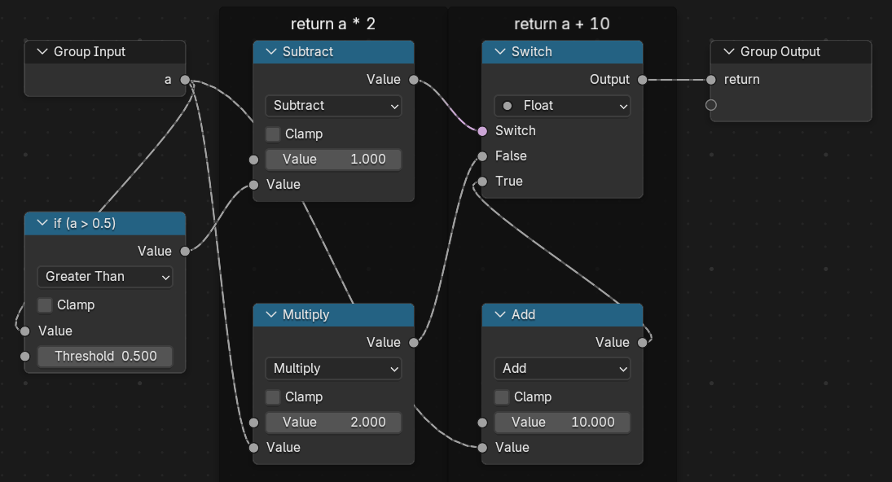
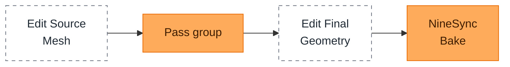
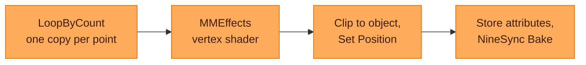
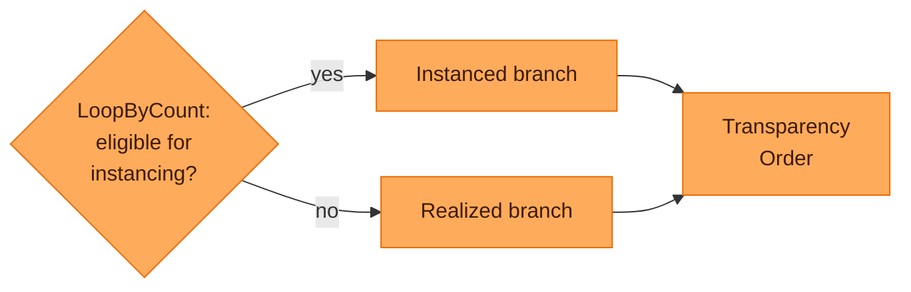

# MME Translation to Geometry Nodes

An MME vertex shader computes a position and other outputs for each vertex. To reproduce that computation in Blender, FX represents the HLSL operations as Geometry Nodes, and it has to tell apart the values known when the effect is built from the inputs that vary while it plays. The examples on this page use the Synth test fixture and Beamman's Thunder lv2.

## How an MME vertex shader becomes nodes

### The interpreter does the work, the backend writes the nodes

`FxExec` interprets the shader symbolically ([one interpreter, three backends](index.md#one-interpreter-three-backends)). A value known at build time, such as a constant, is folded into the result. A value that varies, such as a vertex position or a loop index, must be represented by a node output, and `MmeGeoBackend` emits nodes for the operations on it, emitting each identical operation only once. The same interpreter can instead drive the Python backend, which produces numpy arrays.

This keeps out every node that a constant would make unnecessary, while preserving each operation that depends on runtime inputs. Some constructs cannot be represented by a fixed node graph and need the [Python fallback](#when-an-operation-cannot-be-translated).

### Operation dictionary

<!-- prettier-ignore -->
| HLSL | Blender node | Notes |
|---|---|---|
| `+ - * /` on floats | **Math** (Add, Subtract, Multiply, Divide) | labelled `+`, `-`, `*`, `/` |
| `abs sign floor ceil trunc round frac sqrt rsqrt exp sin cos tan asin acos atan sinh cosh tanh` | **Math** with the matching function | table `MME_NODE_UNARY` in `nodes/backend_base.py` |
| `a ? b : c`, `if / else` | **Switch** nodes (one per value that differs) | both branches are evaluated; the switch picks one ([below](#branches-become-switch-nodes)) |
| `smoothstep(a, b, x)` | **Map Range** (smooth step) | seen in the Line pass below |
| `saturate(x)` | **Clamp** | |
| `a & b`, `a | b`, `a ^ b`, `<<`, `>>`, `~` in a **vertex** shader | **Bit Math** | not available in a pixel shader |
| `mul(float4, float4x4)` etc. | a **shared node group** built on **Matrix Multiply** | HLSL uses row vectors, Blender column vectors; the group transposes when needed |
| `normalize`, `cross`, `dot`, `length`, vector `+ - *` | **Vector Math** | |
| `float4x4` values | Matrix sockets, split with **Separate Matrix** | |
| a user HLSL function (`inv_pow`, `getRandom`) | a shared group `MME fn <name>` | keyed by a hash of the function, so a second effect with the same function reuses it |
| `tex2Dlod` in a vertex shader | **Image Texture** (geometry) | |
| `LoopByCount` / `LoopGetIndex` | **Points → Instance on Points → Realize Instances**, with **Integer Math** for the index | [see Loops](#loops-and-instances) |

<!-- prettier-ignore -->
!!! note "Why 'Math' dominates"
    Blender's Math node performs one scalar operation. An HLSL expression such as `a * b + c` on a `float3` therefore becomes three scalar multiplies and three scalar adds, unless a Vector Math node can express it directly.

### Branches become Switch nodes

A node graph has no control flow; every node is evaluated. FX therefore turns branches into operations on values. When the condition of an `if` is a constant, only the branch it selects is interpreted. Otherwise both branches are interpreted, each under an execution mask: the condition, or its complement, combined with the mask of the code around it. An assignment under a mask does not overwrite the variable but blends with its previous value,

$$x \leftarrow \operatorname{select}(m,\; x_{\text{new}},\; x_{\text{old}}),$$

componentwise and through structures and arrays. On the node backends $\operatorname{select}$ is a **Switch** node. An early `return` uses the same device: a *done* mask collects the cases that have already returned, and the statements after it run under its complement.

For example, this function in an `.fx`:

```hlsl
float f(float a)
{
    if (a > 0.5)
        return a * 2;
    return a + 10;
}
```

becomes the group **MME fn f**, shown here as FX generated it (only the nodes were moved closer together):



The Math node labelled `if (a > 0.5)` is the condition, and each `return` is a frame. The Subtract node forms `1 - condition`, the mask of the cases that have not returned yet, so the **Switch** outputs `a + 10` where the first return did not happen and `a * 2` where it did.

Loops are unrolled. A loop whose condition becomes constant after each iteration, which is the case for loops over constants, parameters or loop counters, is interpreted iteration by iteration up to a limit of 4,096. A loop whose end depends on a per-vertex value cannot be unrolled into a finite tree, so the Geometry Nodes backend reports it as unsupported and the pass runs on Python. Unrolling adds a copy of the loop body to the graph for each iteration, and every data-dependent branch adds nodes for each alternative left after constant folding.

### Example of statement mapping

Three statements from the Beamman's Thunder Line pass (`LineFunc`) and the nodes FX generated for them:

<!-- prettier-ignore -->
| HLSL statement | Generated nodes |
|---|---|
| `float mt = inv_pow(1 - Tr, 2) * 0.5;` | a **Math** node (`1 - Tr`), the group **MME fn inv_pow**, a **Math** multiply named `mt` |
| `float t = smoothstep(0 + index_rnd.y*0.5, 0.2 + index_rnd.y*0.5, 1-Tr);` | three **Math** nodes and a **Map Range** labelled `smoothstep` |
| `CenterPos.xyz = mul(CenterPos.xyz, matRot);` | **Combine XYZ**, **Combine Matrix** and the shared group **MME mul(float3,float4x4)** |

The whole Line vertex shader compiles to **201 nodes** inside one group, among them 111 Math, 35 frames, 12 groups, 9 Combine XYZ, 7 Vector Math, 6 Switch and 3 Clamp, plus shared groups for the camera, the object matrix and the clip-space conversion.

## The pass wrapper and the pass group

The vertex shader of a pass becomes a Geometry Nodes modifier on a mesh object, built from three nested groups. The innermost holds the translated shader. Around it, the **pass group** prepares the geometry, evaluates the shader and turns its output back into positions. The outermost, the **wrapper**, surrounds the pass group with stages for your own nodes and with the bake.



- **Edit Source Mesh** and **Edit Final Geometry** are frames with a pass-through link inside. Nodes you add on that link (Blender inserts them) edit the mesh before the shader reads it, or the finished geometry before it is baked. Both stages are *before* the Bake node, so their edits are part of the bake.
- **Edit Particle Instances** (the pass panel's checkbox, input **Enable Instance Editing**, off by default) exists only on passes made of particle sprites. It turns each particle into an instance, so that nodes in the frame can edit them ([particles and instance editing](#particles-and-instance-editing)).
- **NineSync Bake** is the pass's single managed Bake node, the last node that changes geometry. While you edit, the viewport can show live nodes instead of the bake.
- A **Python bake-only** pass has no such graph: its mesh is written by the frame handler, and its tree holds only the Bake node and a frame stamp. It exposes none of these stages.

Three of the pass group's stages solve problems that a direct translation would get wrong.

**Evaluation once.** A Geometry Nodes field is evaluated again by every node that consumes it. A shader output used by several later nodes, the position and each varying, would otherwise run the whole shader several times. The pass therefore evaluates the shader once and captures all its outputs with one **Capture Attribute** node.

**Clip space back to object space.** A vertex shader outputs a position in Direct3D clip space, $(x, y, z, w)$, but a Blender mesh needs positions in object space. A shared group inverts MMD's projection using the camera's right, up and forward vectors $\mathbf r, \mathbf u, \mathbf f$, its position $\mathbf e$ and the projection's scale factors $x_s, y_s$. In perspective,

$$\mathbf p_{\text{MMD}} = \mathbf e + \frac{x}{x_s}\,\mathbf r + \frac{y}{y_s}\,\mathbf u + w\,\mathbf f .$$

The result is exchanged into Blender's axes, scaled, and transformed by the inverse of the pass object's matrix. Because the camera comes from Blender's active camera, effects that turn towards the camera follow that camera.

**Culling.** The same group decides whether MMD would have drawn each vertex. In perspective, a vertex in front of the camera is culled when its depth lies outside $[0, w]$. A vertex behind the camera is culled only when its depth differs from the value MMD's own projection would produce: a vertex with that natural depth belongs to a triangle crossing the near plane, which Blender's camera clips correctly, while any other depth was placed there by a shader that meant to hide the vertex. Vertices with $w = 0$ or a non-finite coordinate are culled as well. A culled vertex is moved to the origin and flagged with `mme_cull`, which the material turns into zero alpha ([the output stage](shader-translation.md#the-output-stage)).

## A real generated graph

The **pass group** of the Beamman's Thunder _Line_ pass (`MME Pass Thunder_MainTec1_Line`), reduced to its main stages:



The stages in full:

1. **Inputs.** `Group Input` supplies the geometry, **Effect Density**, the loop-count parameter **LineNum** and **Tr**. Named Attribute nodes read `mme_p`, the source vertex position, and `mme_uv` from the mesh.
2. **LoopByCount** (a frame). _Math_ nodes compute the loop count (`LineNum × Effect Density`, rounded, at least 1). **Points** makes that many points, **Store Named Attribute** writes each point's index as `mme_inst`, **Instance on Points** puts one copy of the mesh on every point, and **Realize Instances** turns the copies into one mesh. **Integer Math** turns `mme_inst` back into the shader's `g_index`.
3. **Vertex shader** (`MMEffects`, the 201-node group): everything the HLSL does per vertex.
4. **Clip space to object space.** MME vertex shaders end by writing a clip-space position (`Out.Pos = mul(Pos, ViewProjMatrix)`). The groups **MME Camera (MMD)** and **MME Blender to MMD matrix** supply the matrices, and **MME Clip to object (MMD)** converts the position back.
5. **Set Position.** The vertices are moved there. Vertices MMD would have culled collapse to the origin.
6. **Store Named Attribute** writes what the **material** needs: `mme_cull`, and the shader's outputs as `mmeV_TEXCOORD1_0`, `mmeV_TEXCOORD1_1` and `mmeV_TEXCOORD6_0`, the `Tex` and `Alpha` values. The name is `mmeV_` + semantic + component.
7. **Strip unused attributes**, then, for eligible passes, the Transparency Order switch, then **Hide at Tr = 0**: a **Switch** that outputs empty geometry when `Tr ≤ 0`, added only to passes that FX proved are empty at Tr = 0.
8. **Bake** (`NineSync Bake`) and the **Group Output**.

This walkthrough follows the *realized* path; an eligible pass also contains the [instanced branch](#3-the-affine-check-and-the-instanced-branch).

<!-- prettier-ignore -->
!!! tip "Open it yourself"
    Select a pass object, open a **Geometry Nodes** editor and look at the **MME** modifier. Press **Tab** on the group node to enter it, and **Tab** again to leave.

## Loops and instances

MME effects often draw the same mesh many times, each copy with a different index (`LoopByCount=LineNum; LoopGetIndex=g_index;`). FX handles this with three **separate** mechanisms, which are easy to confuse, so each has its own subsection below.



### 1. LoopByCount creates instance points

For nested loops with counts $c_1, \dots, c_K$ and the **Effect Density** setting $\rho \in [0, 1]$, the number of copies of each loop, the total, and the index $\ell_k$ that copy $i$ sees in loop $k$ are

$$n_k = \max\bigl(1, \operatorname{round}(\rho\, c_k)\bigr), \qquad N = \prod_{k=1}^{K} n_k, \qquad \ell_k = \Bigl\lfloor i \Big/ \prod_{j > k} n_j \Bigr\rfloor \bmod n_k .$$

This is a mixed-radix decomposition of $i \in \{0, \dots, N-1\}$ in which the innermost loop varies fastest.

1. **Points** makes $N$ points, and each stores its index $i$ as the integer attribute `mme_inst`.
2. **Integer Math** recovers each loop variable from `mme_inst` by division and modulo, as above, so nested loops see the right indices.
3. For the material, the loop index is stored as `mmeL_<variable>`: on the vertex in the realized branch, on the instance in the instanced one.

In the *realized* branch the points become geometry through **Instance on Points → Realize Instances**: one copy of the already reduced mesh per point, each copy real geometry that knows its index. Density thins out a particle effect proportionally, and it is the main control over its cost.

<!-- prettier-ignore -->
!!! warning "Realize Instances is the expensive step"
    After **Realize Instances** every copy is real geometry, so memory and bake size grow with the loop count. Pruning before this stage ([Culling](culling.md)) is what keeps the realized graph affordable. Realizing is **not unconditional**: passes that qualify for the instanced branch below do not need it in the live output.

### 2. The per-particle shader stage

Many vertex shaders compute values that depend only on the loop index, such as a random direction per bolt or a timer per particle. Evaluated naively, that work is repeated for every vertex of every copy. The **Per-Particle Shader Stage** (`mme_particle_split` in `nodes/geo_split.py`; the setting **Per-Particle Shader Stage**, on by default) moves it out.

- **Classification.** The splitter classifies every value in the vertex shader as *constant*, *per-particle* (it depends only on the loop index and constants) or *per-vertex*.
- **Extraction.** Pure per-particle work moves into its own group, evaluated **once per copy** on the loop points, when moving it saves enough nodes (at least four). The values the per-vertex part needs are stored as point attributes (`mme_pp_*`) and **sampled back** by the per-vertex graph through the point index (`mme_point`), so they are never copied onto the realized mesh.
- **Skipped** when no input depends on the loop index alone, when too few nodes would move to be worth it, or when a value has a type that cannot be stored as an attribute. The log gives the reason: `vertex shader stays per vertex (<reason>)`.
- The toggle is part of the build signature of looped passes on the Geometry Nodes backend ([incremental rebuilds](index.md#incremental-rebuilds)).

#### Edit Particle Points

The points the per-particle stage works on are exposed as a user stage, **Edit Particle Points**: a node group linked into the pass and keyed by the pass's owner, so that a rebuild links the *same* group back in. It belongs to you, not to the generator. It receives the points, one per copy, after the per-particle part of the shader.

- **Delete a point**, and that copy is not spawned.
- **Move a point**, and that copy's result is offset by the move: the realized vertex minus its source vertex is added after the shader.
- **Edit the stored per-particle values** (the `mme_pp_*` attributes) to change that copy's shader inputs.

These are edits to *points* (domain: Point). They are different from editing *sprite instances*, which exist only in particle-sprite passes ([particles and instance editing](#particles-and-instance-editing)).

### 3. The affine check and the instanced branch

In many looped passes the vertex shader moves each copy **rigidly**: the clip-space position of every vertex is one affine function of its source position, per particle. Drawing every copy as real geometry is then wasteful. FX can instead draw the copies as **instances** of the source mesh and run the shader on only a few *reference vertices* per particle.

Whether a pass qualifies is decided once, **when the pass is built**, by a numerical probe (`mme_affine_plan` in `runtime/affine.py`):

- it samples probe states (the build frame's camera, a distant probe camera, each opacity probe value and a later frame), copies and source vertices, up to 24 copies and 256 vertices;
- it checks that an affine map of the source position reproduces the clip-space position of each copy within a small tolerance, and that a copy's vertices are culled together;
- for each output the pixel shader needs (a *varying*), it looks for the smallest group of features (position, normal, UV) from which that output can be rebuilt, per copy;
- it picks a small set of **reference vertices** that span those features, and verifies the rebuild through exactly those vertices and weights.

If a required varying cannot be rebuilt from position, normal or UV, or the pixel shader could not be converted, the pass falls back to ordinary evaluation, the realized branch, and the log gives the reason. **A pass that passes the probe is eligible, not guaranteed identical for every input.** The check samples states, so an input outside the probed range could in principle behave differently. The instancing tests in `tests/t_instanced.py` build a fixture that passes and several that do not, which can serve for comparison.

### Transparency Order

For an *eligible* looped pass, FX builds more than one way of drawing it, and a switch picks between them live. The **Transparency Order** setting (Effects panel; a **scene** default, with a per-accessory override under **Effect Controls**) selects:

<!-- prettier-ignore -->
| Setting | What is drawn (eligible passes only) |
|---|---|
| **Full Shader** | the realized branch: the vertex shader runs on every vertex of every copy. Slowest, and the reference for the other two |
| **MMD Order** (default) | order-independent blend modes (additive, opaque) stay instanced; see-through passes are *reconstructed* into one mesh in MMD's draw order from a few vertices per copy |
| **Blender Sorted** | every such pass is drawn as instances. Fastest. Cycles renders the same as the other levels, but EEVEE sorts transparent copies by distance instead of using MMD's order, which can change how overlapping copies blend |

Passes that are not eligible ignore the setting. Changing it only flips switches between branches that were **already generated**, so it takes effect **without a rebuild** and is not part of the build signature. A pass that was already **baked** keeps the branch it was baked with, and the new order shows after **Bake Changed**. A comparison between the modes holds only for an eligible graph and for the renderer used.

## Attributes FX writes

FX passes source geometry, loop indices and vertex-shader outputs between stages as named attributes. Their domains, types and lifetimes are listed in [Generated Attributes](../geometry-nodes/generated-attributes.md).

## From MME parameters to Blender controls

### How FX decides what to expose

FX scans the `.fx` globals. A global becomes a user-facing **parameter** when **all** of these hold (`fx_find_params` in `fx/params.py`):

- it is a plain `float`, `int` or `bool`, or a vector of up to four floats, such as a colour;
- it has **no hardware semantic**, so it is not `WORLDVIEWPROJECTION`, `TIME`, `POSITION` or similar;
- it is not `static` or `const`, not an array, not a loop counter, and not one of the add-on's internal flag names;
- it has an **initial value** or a **UI annotation**, and is not marked `UIVisible = false`.

### What it looks like: the Synth effect

<!-- prettier-ignore -->
| In `synth.fx` | Blender control | Why |
|---|---|---|
| `float Spread < UIWidget="Slider"; UIMin=0; UIMax=10; > = 2.5;` | root property `mmeP_Spread`, slider 0–10, default 2.5; modifier input **Spread** (driven) | an obvious user knob; the range comes from the annotations |
| `float3 Tint < UIWidget="Color"; > = float3(1, 0.5, 0.25);` | root property `mmeP_Tint` (colour); inputs **Tint.x / .y / .z** | colours are edited as colours |
| `int Copies = 4;` | root property `mmeP_Copies`; input **Copies**; also the loop count | structural: changes how many copies exist |
| `bool Hidden < bool UIVisible=false; > = true;` | **not exposed** | the author hid it |
| `float Time : TIME;` | **not a parameter**: it becomes the **ElapsedTime** / scene-time input | MMD supplies it, not the user |
| `float4x4 WVP : WORLDVIEWPROJECTION;` | not a parameter: built from the camera and object groups | MMD supplies it |
| `float Tr : CONTROLOBJECT < string name="(self)"; string item="Tr"; >` | modifier input **Tr**, driven from `mme_tr` on the accessory | opacity from the PMM |

These come from a real build of the Synth fixture, whose Geometry Nodes pass has the inputs _Effect Density, Copies, Spread, Tr, Tint.x, Tint.y, Tint.z, Viewport width, Viewport height_ and _ElapsedTime_.

### And the real effect

Beamman's Thunder lv2 declares `MainColor`, `ParticleNum`, `LineNum`, `FlashNum` and `WaveNum`, and FX stores all five on the root. The _Line_ pass's modifier shows only **Effect Density**, **LineNum** and **Tr**, because that pass's shader reads only those; the others are not wired into it. `MainColor` reaches the material instead ([the shader it came from](shader-translation.md#the-shader-it-came-from)).

<!-- prettier-ignore -->
!!! info "Parameters stay on the root"
    You edit values on the accessory root (**Selected Effect > Effect Parameters**). The modifier inputs and material uniforms are driven from there, so a value typed directly into a driven modifier input is overwritten by its driver.

`LineNum` changes the number of loop copies and is therefore structural: in a test, changing it from 28 to 20 marked the effect for rebuilding and changed all four pass signatures.

## A practical example: a camera-facing ribbon

The _Line_ pass turns thin quads into a bolt that always faces the camera. The relevant HLSL, shortened, is:

```hlsl
float3 V = normalize(CenterPos - NextCenterPos);   // along the bolt
float3 E = normalize(CameraPosition - CenterPos);  // towards the camera
float3 side = normalize(cross(E, V)) * 1.5 * 10 * length(WorldMatrix[1]) * 0.1 * 0.5;
Pos.xyz = CenterPos.xyz;
if (PosBuf.x > 0) { Pos.xyz += side; } else { Pos.xyz -= side; }
```

**What it does.** Each vertex of the ribbon is pushed to the left or right, perpendicular both to the bolt's direction and to the direction of the camera, so the ribbon is always seen face-on. This is a **spatial relationship** (bolt direction × camera direction) plus a **deformation** (an offset by `side`).

**What FX generates.** A **Vector Math** _normalize_ for each of `V` and `E` (frames `float3 V…` and `float3 E…`), a **Vector Math** _cross_ for the perpendicular, **Switch** nodes for the `if (PosBuf.x > 0)` branches (both sides are computed, and the switch picks one per vertex), and finally the clip-space conversion. `CameraPosition` is a group input fed from Blender's active camera, so moving the camera in Blender turns the ribbons.

**What you can change safely.** Use the exposed values (**LineNum**, **MainColor**, **Tr**, **Effect Density**) rather than the nodes. Editing nodes inside the generated group is fragile, as the next section explains.

## Customizing the generated graphs

Exposed parameters are the intended controls of a generated effect. The generated nodes inside a pass are **not** an editing surface, because they are replaced whenever the pass is rebuilt. FX provides specific places for your own nodes instead ([the pass wrapper](#the-pass-wrapper-and-the-pass-group)), and those are carried across rebuilds.

### Which edits survive rebuilds

Where your nodes live decides what a rebuild does to them, because a pass whose [build signature](index.md#incremental-rebuilds) changed gets a **new** tree.

<!-- prettier-ignore -->
| What you edited | On a rebuild that replaces the pass | Mechanism |
|---|---|---|
| Nodes in **Edit Source Mesh** or **Edit Final Geometry** | captured from the old wrapper and restored into the same frames of the new one | `mme_capture_frames` / `mme_restore_frames` (`nodes/user_frames.py`) |
| **Edit Particle Points** group | the same group is linked back in | it belongs to the user and is keyed by the pass's owner, so cleanup never deletes it |
| Nodes in the sprite **Edit Particle Instances** frame | not covered by the frame capture above; check it separately on your build | – |
| Nodes inside the generated pass group, or a generated branch | **lost**: replaced with the new tree | – |
| The pass material | see below | – |

What can be restored is limited: the nodes *inside the frame*, with their settings and links, and links to the two ends of the frame. A copy that **cannot** be fully restored (Repeat, Simulation or For-Each zones, links to nodes outside the frame, a setting that no longer exists) is counted as lost, and FX then **keeps the previous wrapper**, renamed and with a fake user, so that you can recover what did not carry over. Test complex zones, external links and edits to generated branches before relying on them.

An unchanged pass keeps everything: the object, the tree, your frames and its bake. After a rebuild the pass's visibility flags and action are carried over, and a pass whose replacement fails stays as it was.

**Materials.** A controlled test on an earlier build showed that an edited material kept its edit once (FX logged *material was edited; only its pixel shader group was regenerated*) and was reset on a second consecutive rebuild. Treat this as an observation to verify again on your build, not a guarantee. Which material to edit is explained in [the instanced material](shader-translation.md#the-instanced-material).

## Particles and instance editing

A pass whose mesh is made of quads, one quad per particle, gets the larger wrapper shown above. Its sprite section, between the pass group and **Edit Final Geometry**, is a frame titled *Edit Particle Instances (needs the panel checkbox)* and contains:

1. **Particles to Instances**: one instance per particle, placed at the particle's centre;
2. a **Delete Geometry** node in the *Instance* domain, labelled *Your nodes here: particle instances*, a placeholder whose selection is `False`, for your own logic;
3. **Realize Instances**, and removal of the internal `mme_sprite` attribute;
4. a **Switch** driven by the group input **Enable Instance Editing**, the pass panel's **Edit Particle Instances** checkbox. It is off by default, because on large effects it costs far more than the pass itself;
5. **Particle Mesh (optional swap)**: an object input whose mesh, when set, replaces each particle.

Everything here sits *before* the Bake node, so these edits are part of the bake; after changing them, use **Bake Changed**. Sprite instances (domain: Instance) are a different thing from **Edit Particle Points** (domain: Point), which every looped pass has.

## When an operation cannot be translated

FX tries the Geometry Nodes build first. When the interpreter meets something whose value it cannot know without running the shader per vertex, it raises _unsupported_, and **only that pass** falls back to the Python backend. The effect's other passes stay on Geometry Nodes.

<!-- prettier-ignore -->
| Cause | Message in the log | Example in the Synth fixture |
|---|---|---|
| A loop whose count depends on vertex data | `data-dependent loop` | `for (int j = 0; j < (int)(Tex.x * 4 + 1); j++) { acc += 0.1; }` |
| An unknown intrinsic function | `unknown function <name>` | – |
| A struct constructor | `struct constructor` | – |
| An array whose size is not a constant | `array size is not constant` | – |
| A chain of function calls deeper than the limit | `call depth exceeded` | – |
| A loop that does not end within the limit (4,096 iterations) | `loop did not finish` | – |

A real example, from building the Synth fixture:

```text
effect pass Synth_T_P1: vertex shader cannot run in Geometry Nodes (data-dependent loop); using the Python backend
effect pass Synth_T_P1: Python, 49 vertices, 72 faces, 1 instance(s), fallback material
```

**What changes for you:** that pass has no node tree to edit, because its geometry is written into the mesh each frame and its tree only holds the Bake node. Its **Live Effect Preview** follows the setting, and the **Passes** tab shows **Python** beside it. The rest of the effect is unaffected.

## Related pages

- Source: [`nodes/geo_tree.py`](https://github.com/sen-trie/nine-sync-fx/blob/master/nodes/geo_tree.py),
  [`nodes/backend_geo.py`](https://github.com/sen-trie/nine-sync-fx/blob/master/nodes/backend_geo.py),
  [`nodes/geo_sprites.py`](https://github.com/sen-trie/nine-sync-fx/blob/master/nodes/geo_sprites.py),
  [`fx/params.py`](https://github.com/sen-trie/nine-sync-fx/blob/master/fx/params.py)
