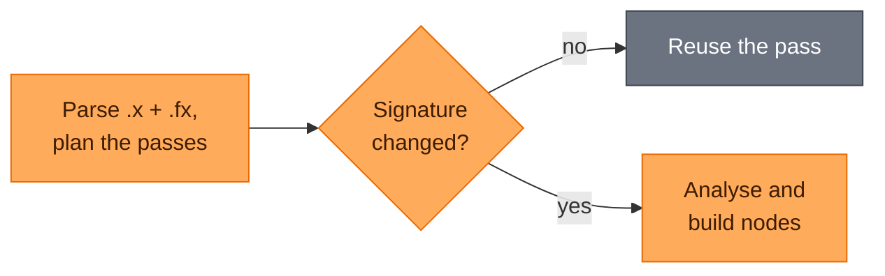
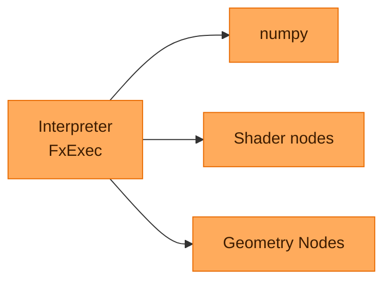

# FX Architecture

MME effects describe rendering in HLSL for the GPU, while Blender represents geometry and shading with two separate node systems. FX has to translate the one into the other, keep the effect's inputs editable, and rebuild an effect repeatedly without discarding work that has not changed. This page describes the pipeline that results; the pages after it explain its stages and their limits. Where FX sits among the other components is shown in [How the parts fit together](../../index.md#how-the-parts-fit-together).

## What MME effects are, in Blender terms

An MME effect is a Direct3D 9 effect file: HLSL source that declares global variables, functions, texture samplers and *techniques*. A technique is a sequence of *passes*, and each pass binds a vertex shader, a pixel shader and render states such as the blend mode and culling. Globals carry *semantics* and *annotations* that tell MME what to put into them, such as `WORLDVIEWPROJECTION` for the transformation matrix or `TIME` for the elapsed time. The table maps each of these onto what FX makes of it.

<!-- prettier-ignore -->
| In the `.fx` | What it is | What FX makes of it |
|---|---|---|
| **technique** | one way of drawing, chosen by `MMDPass` (`object`, `shadow`, `edge`…) and an optional `Subset` | FX uses `object` techniques (falling back to `object_ss`) and ignores `edge`, `shadow` and `zplot` techniques |
| **pass** | one draw call inside a technique | one **pass object** in Blender (a mesh with a Geometry Nodes modifier and a material) |
| **script** (`LoopByCount`, `LoopGetIndex`, `Pass=`) | repeats passes, so one pass draws the mesh N times | N copies of the mesh made inside the Geometry Nodes tree, each with its own index |
| **vertex shader** | decides where each vertex goes | a Geometry Nodes tree, or a Python (numpy) calculation |
| **pixel shader** | decides the colour and transparency of each pixel | a material: Shader Nodes |
| **parameters** (`float Speed = 1;`) | values the user is meant to tune | custom properties on the accessory root |
| **`CONTROLOBJECT`** | reads another object, bone or morph from the MMD scene | a link to a Blender object, bone, morph or shape key |
| **render targets / `Draw=Buffer`** | off-screen buffers and full-screen passes | not supported ([below](#what-is-supported)) |

## The pipeline

FX parses the source files, plans the draws and works out each draw's dependency signatures *before* it builds anything. Only a changed or new pass goes on to sampled analysis, which probes the shader and reduces the source geometry before any node is generated. This order limits how much geometry reaches the later stages; [Culling and Geometry Optimization](culling.md) explains the sampling and where it can be wrong.

The front end has four stages. A preprocessor expands `#define` macros with arguments, `#if` blocks and `#include` files, reading UTF-16, UTF-8 or CP932 source. A recursive-descent parser builds a syntax tree. Technique planning picks, for each material subset, the first technique whose `MMDPass` is `object` and then `object_ss`, the passes MMD uses to draw an object, and turns the technique's script into a list of draws with their loops. Finally every global is classified by its source: camera, light or object matrices, positions and directions, material colours, time, viewport size, controller values, built-in flags, or a user parameter that FX exposes as a slider.

The three ways of evaluating a pass are separate. A **Geometry Nodes** pass is evaluated by Blender from its node tree. A **Python** pass has its mesh recomputed by the frame handler, and always when rendering. A **baked** pass reads stored frames, and neither the generated part of its tree nor the handler runs for it.

The build is coordinated by `mme_build_effect` in `runtime/build_effect.py`, and each pass is handled by `mme_build_pass` in `runtime/build_pass.py`. Parse and probe results may be reused through the [build cache](cache.md#the-build-cache).

A **binary** `.x` is read as plain geometry for accessories and stays outside the effect path. The text reader is tuned for large meshes: its tokenizer groups runs of numbers into one block, and its parser takes each block in one step, producing the same parse tree as reading the numbers one by one.

A measured build of Beamman's Thunder lv2 illustrates the pipeline. Draw planning produced five draws, and four of them kept geometry after reduction. [Culling and Geometry Optimization](culling.md#a-real-run-beammans-thunder-lv2) examines the reduction, and [MME Translation to Geometry Nodes](geometry-nodes-translation.md#a-real-generated-graph) the resulting Line pass.

## One interpreter, three backends

FX does not compile HLSL into another language. It interprets the syntax tree once, symbolically, with an interpreter (`FxExec`) that delegates its arithmetic to a *backend*. Every value is split into scalars, a `float4` into four and a `float4x4` into sixteen, so that a backend needs only operations on single numbers and a few vector and matrix shortcuts.

The **numpy backend** computes real values for all vertices at once. It is the reference implementation, the runtime of a Python pass, and the evaluator on which the [reduction analyses](culling.md) run. The **shader-node backend** emits nodes into a material group and the **Geometry Nodes backend** into a node tree; on these two a scalar is either a constant or a node socket. Constants are folded when the effect is built, identical subexpressions are emitted once, and identities such as $x + 0$ and $x \cdot 1$ produce no node. How each HLSL construct becomes a node is described in [MME Translation to Geometry Nodes](geometry-nodes-translation.md#how-an-mme-vertex-shader-becomes-nodes).

Each pass is built on one of the two vertex backends:

<!-- prettier-ignore -->
| | Geometry Nodes backend (`MmeGeoBackend`) | Python backend (`FxNumpyBackend`) |
|---|---|---|
| Emits | nodes in a tree | numbers in numpy arrays |
| Result in Blender | mesh of kept source vertices + a node tree that moves them | a mesh whose vertex positions are written per frame, plus a tiny tree that only holds the Bake node |
| Per frame | Blender evaluates the tree; drivers feed inputs | a frame-change handler recomputes the mesh (**Live Effect Preview** can turn this off) |
| Editable | yes, you can open the group | no meaningful tree |
| When | default | **Effect Backend = Python**, or automatic fallback for one pass |

An effect can mix both, because each pass decides for itself. The **Passes** tab in **Effect Details** shows the backend of each pass.

## Parameters, controllers and linked objects

**Parameters** become custom properties on the accessory root (`mmeP_<Name>`). Geometry Nodes inputs and material uniforms are fed from them by **drivers**, so most edits take effect live. A parameter read by the vertex shader or used as a loop count is **structural**: it changes which geometry exists, so editing it marks the effect out of date.

**Controllers** (`CONTROLOBJECT`) are resolved once and stored as JSON on the root (`mme_controls`). An effect that reads a controller also gets a keyable _use_ switch. A controller can read the accessory itself (its transform, Tr and Si), another object, a morph keyed on the root, a shape key (live), a bone or a model. One that matches nothing is shown as _missing_, together with the values it falls back to.

**Overrides.** If the effect assigns a parameter inside an `if` that reads a controller, the parameter is recorded as overridden and greyed out in the interface while that controller is linked and enabled.

## Incremental rebuilds

Every pass object stores two things. Its **pass key** (`mme_pass_key`) is a hash of the root's identity, the technique, the pass, the subset, the draw order and a duplicate index, but never the object's name. Its **manifest** (`mme_manifest`) is a canonical JSON record of how it was built.

The **build signature** is a SHA-256 digest over two groups of inputs: `mme_shared_inputs`, which are the same for every pass of the effect, and `mme_build_inputs`, which belong to this draw alone.

- **Shared:** the contents of the `.fx` and its includes, the `.x` and the textures the effect names; the density, the tolerance, the pre-cull flag, the **Per-Particle Shader Stage** flag, the backend and the unit; the sampled animation variants, Tr and Si, the bound light and the effect controls.
- **Per pass:** the schema and `MME_GRAPH_VERSION`, so that a change to how graphs are generated rebuilds old passes; the draw's identity and loops; the material subset's colours and texture; and the parameters and controls that the pass's vertex **or pixel** shader reads. Pixel shaders count because alpha gates prune geometry. A keyed parameter contributes its whole key curve, not its current value.
- The **particle split** enters only for a looped pass on the Geometry Nodes backend, so toggling it does not rebuild other passes.
- On the Python backend, the root's transform and its dependencies are included as well.

Pass names and positions are **not** inputs. Nor is a **branch switch** such as [Transparency Order](geometry-nodes-translation.md#transparency-order): it selects between branches that were already generated, so changing it rebuilds nothing. A setting that changes *which graph is generated*, such as the split toggle, the tolerance or the density, is an input and does rebuild.

On a rebuild, `mme_rebuild_effect` and a PMM sync reconcile each planned pass through the same function (`mme_build_decision`), which compares the planned signature with the stored one:

<!-- prettier-ignore -->
| Decision | Result |
|---|---|
| unchanged | the object, mesh, modifier, node tree, drivers, visibility, keys and **bake** stay |
| known empty (the draw produced nothing last time with this signature) | skipped without analysis (`mme_empty_passes`) |
| changed | that pass is built anew; once it succeeds the old one is replaced, its hide flags and action are carried over, [supported edit stages](geometry-nodes-translation.md#which-edits-survive-rebuilds) are restored, and its old bake is dropped |
| changed but the new build fails | the working pass **stays** (the failure is reported and the sync outcome says the previous build is kept) |
| no longer planned | removed |
| built before manifests existed | replaced once |

A **rebuild** is decided by these build signatures. A **bake** has a signature of its own ([Cache Architecture](cache.md#the-bake-signature)).

## Frame evaluation

- **Geometry Nodes passes:** Blender evaluates the tree. Its inputs are driven from the root's properties, the scene time and the objects the effect reads.
- **Python passes:** `mme_frame_handler` recomputes the vertex positions on a frame change while **Live Effect Preview** is on, and always when rendering. It works per pass: only the passes flagged for it and visible in the viewport (or in the render) are recomputed, and a baked pass is skipped, because its stored frames are read instead.
- **Core's internal frame steps:** while Core steps frames for its own solves, the handler returns at once ([internal frame stepping](../../core/pmm-sync/how-it-works/accessory-fx-integration.md#internal-frame-stepping)). FX's own bake-only evaluation is exempt, since a bake needs the handler to run.
- **Baked passes:** the stored frames are read, and the handler no longer runs for them.

## Baking architecture

Each pass contains one managed `NineSync Bake` node, the last node that changes geometry. The bake records the result per frame, so what you see in the viewport and the render is the stored geometry. [Enable Geometry Node Editing](../geometry-nodes/index.md#editing-the-generated-nodes) is a plain modifier value after the Bake node, so switching it changes no bake input. [Cache Architecture](cache.md#the-bake-signature) describes the bake's signature, storage, validation and eviction.

## What is supported

<!-- prettier-ignore -->
| Area | Supported | Approximation or fallback | Not supported |
|---|---|---|---|
| Techniques | `object` (then `object_ss`), subsets | draws to off-screen targets are emulated by drawing their source shading directly | `edge`, `shadow`, `zplot`; full-screen `Draw=Buffer` |
| Vertex shaders | most arithmetic, vectors, matrices, loops with constant counts, user functions, texture reads | **data-dependent loops** → that pass runs on Python | unknown functions, struct constructors, calls deeper than the limit |
| Pixel shaders | arithmetic, textures with filtering and wrap/clamp/mirror, discard, six blend modes | unrecognized blend states → normal alpha blend; unconvertible shader → plain material | bit operations in a pixel shader; textures inside shared shader functions |
| Loops | `LoopByCount`, `LoopGetIndex` | scaled by **Effect Density** | – |
| `.x` | text `.x` | – | binary `.x` cannot drive an effect |
| Controllers | objects, bones, morphs, shape keys, self | unmatched → constant, assignable by hand | – |

## Related pages

- Source: [`runtime/build_effect.py`](https://github.com/sen-trie/nine-sync-fx/blob/master/runtime/build_effect.py),
  [`runtime/build_pass.py`](https://github.com/sen-trie/nine-sync-fx/blob/master/runtime/build_pass.py)
