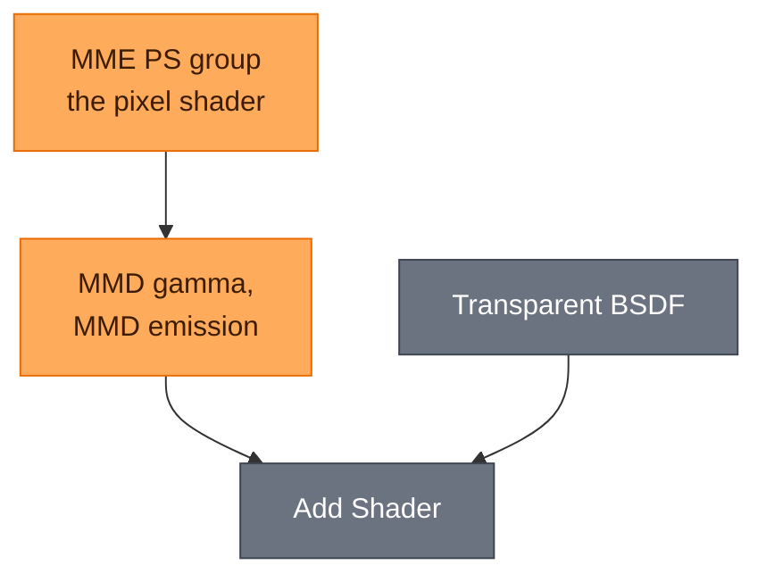

# Shader Translation

The **pixel shader** of an MME effect decides the colour and transparency of every pixel. FX turns it into a **material** in two parts:

1. a node group **`MME PS <pass label>`** that holds the effect's own arithmetic, translated from the HLSL, and
2. a fixed **output stage** after it, chosen from the pass's Direct3D blend states, that reproduces how MMD blends and gamma-corrects the result.

The pixel shader moves no vertices. Whatever it needs from the vertex shader, such as texture coordinates, a fade value or the loop index, arrives as a **mesh attribute** that the [Geometry Nodes pass](geometry-nodes-translation.md) stored. Values that are the same over the whole scene, such as material colours or controller values, arrive as object attributes driven from the accessory.

**Instanced passes hand over differently.** The paragraph above describes the **realized** branch, in which the vertex shader runs on every vertex and stores each varying as `mmeV_*`. A looped pass that passed the [affine check](geometry-nodes-translation.md#3-the-affine-check-and-the-instanced-branch) and is drawn as instances uses a separate material ([the instanced material](#the-instanced-material)). The ordered (MMD Order) branch realizes its instances back into one mesh, rebuilds each varying per vertex and writes the ordinary `mmeV_*` attributes, so it uses the ordinary pass material.

## A real material

The material of the Beamman's Thunder _Line_ pass has **17 nodes**, and its pixel-shader group has **28**. Reduced to its main stages:



To open the group, select it in the Shader Editor and press **Tab**.

### The shader it came from

The Beamman's Thunder effect uses one pixel shader for all its passes and selects the behaviour with a `mode` argument. The Line pass uses `Main_PS(…, 2)`, and the shader begins:

```hlsl
float4 Main_PS(VS_OUTPUT IN, uniform int mode) : COLOR0
{
    float t = IN.t;
    float4 Col = 1;

    if (bController)
    {
        MainColor.rgb = float3(morph_r, morph_g, morph_b) * (1 + morph_add_si);
    }

    if (mode == 0)
    {
        Col = tex2D(SampParticle, (IN.Tex * 0.5) + float2(0.5, 0.0));
        ...
```

Three things happen when FX translates it.

- `mode` is a **uniform argument**, a constant for this pass, so the interpreter folds every `if (mode == …)` when the effect is built. Only the branch for this pass produces nodes, which is why the Line material is much smaller than the whole function suggests.
- `IN.t` and `IN.Tex` are **vertex-shader outputs**. In the material they become **Attribute** nodes reading `mmeV_<SEMANTIC>_<k>`, the attributes the Geometry Nodes pass stored.
- `MainColor` is a global without a semantic, so it is an exposed parameter. Because the pixel shader reads it, it becomes a material **uniform**: a custom property `mmeU_MainColor_0..2` on the pass object, driven from the root's `mmeP_MainColor`. Changing it takes effect live, without a rebuild.

## What each HLSL construct becomes

<!-- prettier-ignore -->
| HLSL | Shader node | Notes |
|---|---|---|
| `tex2D(sampler, uv)` | **Combine XYZ** → **Image Texture** → **Separate Color** (+ the texture's Alpha) | `v` is replaced by `1 - v` because HLSL texture space starts at the top and Blender's at the bottom. Samples are cached per image and coordinate |
| arithmetic, `lerp`, `saturate`, `pow`… | **Math**, **Vector Math**, **Mix**, **Clamp** | the same translation tables as the vertex shader ([operation dictionary](geometry-nodes-translation.md#operation-dictionary)) |
| `if` / `?:` on a value that varies per pixel | **Switch** / **Mix** nodes | both branches are computed |
| `if` on a constant (a uniform argument like `mode`) | nothing: folded at build time | |
| `IN.<semantic>` | **Attribute** node `mmeV_<SEMANTIC>_<k>` | |
| loop index (`LoopGetIndex`) | **Attribute** node `mmeL_<var>` | |
| global parameter read by the pixel shader | driven custom property `mmeU_<name>_<k>` on the pass object, read with an **Attribute** (object) node | |
| a user function called with a texture | not supported ([below](#unsupported-operations-and-approximations)) | |

### Textures

- Each image is loaded **once per file**, matched by normalized path, in the **Non-Color** colour space, so that Blender adds no gamma of its own on top of the shader's.
- `ResourceName` paths are resolved as described in [Textures](../shader-nodes.md#textures).
- The sampler state (linear or point filtering; clamp, wrap or mirror) is copied to the Image Texture node's _Interpolation_ and _Extension_.
- Render-target textures are not images. They come from off-screen passes, which FX emulates ([FX Architecture](index.md#the-pipeline)).

## The output stage

What a pixel shader computes is a colour that Direct3D then blends into the frame according to the pass's render states. The pixel-shader group therefore has two outputs, **Color** and **Alpha**, and FX reads the states `SrcBlend`, `DestBlend`, `BlendOp` and `AlphaBlendEnable` to pick one of six output stages. The chosen mode is shown in a frame title inside the material (_MMD blending: …_).

<!-- prettier-ignore -->
| Mode | Render states | Result | Stage |
|---|---|---|---|
| **Opaque** | `AlphaBlendEnable = FALSE`, or `ONE`/`ZERO` | $C$ | Emission → Output |
| **Alpha blend** | `SRCALPHA`, `INVSRCALPHA` (the default) | $\alpha C + (1-\alpha) D$ | Mix Shader (Transparent ⟷ Emission) by Alpha |
| **Additive** | `ONE`, `ONE` | $C + D$ | colour × visible → Emission + Transparent via Add Shader |
| **Additive (alpha)** | `SRCALPHA`, `ONE` | $\alpha C + D$ | colour × alpha → Emission + Transparent via Add Shader |
| **Premultiplied** | `ONE`, `INVSRCALPHA` | $C + (1-\alpha) D$ | Emission added to a black/transparent mix by alpha |
| **Multiply** | `ZERO`/`SRCCOLOR` or `DESTCOLOR`/`ZERO` | $C D$ | Transparent BSDF coloured by the result |

$C$ and $\alpha$ are the shader's colour and alpha, and $D$ is the colour already in the frame. Any other combination, or a `BlendOp` other than Add, falls back to **Alpha blend**.

All six modes start the same way, and each step is a labelled node in the material:

1. **Culled vertex (mme_cull)**: the attribute the Geometry Nodes pass wrote for vertices outside the view volume. `Visible = 1 - culled`, and **Alpha = effect alpha × Visible**, clamped, so a vertex MMD would not draw is transparent.
2. **MMD gamma**: a **Gamma** node set to **2.2** on the effect's colour, because MMD blends colours as they are displayed.
3. **MMD emission**: the colour is output as **Emission** of strength 1, since an effect's colour is light, not a lit surface.

The material blends (`BLENDED`) in every mode except opaque, which uses `DITHERED`. Back-face culling is on only when the pass sets `CullMode` to CCW. The Gamma and Emission nodes are the ones exposed in **Pass Material** ([Shader Nodes Setup](../shader-nodes.md#pass-material)).

### Why the gamma step is exact only at the ends

MMD blends gamma-encoded colours, in display space. Blender blends in linear space and encodes for display afterwards. Writing $\gamma = 2.2$ and approximating the sRGB curve by a pure power, an alpha-blended pass gives

$$D_{\text{MMD}} = \alpha C + (1 - \alpha) D, \qquad D_{\text{Blender}} = \bigl(\alpha C^{\gamma} + (1 - \alpha) D^{\gamma}\bigr)^{1/\gamma}.$$

The two agree when $\alpha$ is 0 or 1 and differ in between: half-transparent white over black displays as 0.5 in MMD and as $0.5^{1/2.2} \approx 0.73$ in Blender. Additive passes behave the same way, $C + D$ against $(C^{\gamma} + D^{\gamma})^{1/\gamma}$, so overlapping glows add up to less in Blender than in MMD. This follows from blending in different spaces; it is derived here, not measured. View transforms other than Standard, such as AgX, add their own tone curve on top. This is the reason the Gamma node is exposed in the pass material.

## The instanced material

A pass drawn as instances has no per-vertex shader output to store, so its pixel shader needs another source for each varying. FX makes a second material for it: a **copy of the pass material**, made fresh on every build, that **shares the pass's pixel-shader group** (`MME PS …`) and differs only in where the varyings come from.

- Every varying the plan covers is **reconstructed** from per-instance coefficients (`mmeA_<semantic>_<k>_k`, `_p`, `_n`, `_uv`) and the vertex's own position, normal or UV (`mme_p`, `mme_n`, `mme_uv`), as *constant + weight · feature*.
- Loop variables (`mmeL_*`) are read from the **instance**, with an Attribute node of type *Instancer*.
- Anything the plan cannot cover keeps the pass's ordinary handling, and a pass whose varyings cannot all be covered does not use this branch at all.

The copy is a separate material because **EEVEE allows a material only 14 Geometry attributes**, and the realized varyings already come close to that limit.

The three materials have different owners. The **ordinary pass material** is the one you edit ([Shader Nodes Setup](../shader-nodes.md#pass-material)). The **generated shader group** is regenerated when the pass is rebuilt. The **instanced copy** is replaced on every build, so edit the ordinary material, never the copy. Which of them you see depends on the [Transparency Order](geometry-nodes-translation.md#transparency-order) and on whether the pass is eligible.

## Unsupported operations and approximations

When the pixel-shader translation meets something it cannot express, **only that pass** loses its translated shader. The pass keeps its geometry, gets a **plain material** instead, and the build log says why.

<!-- prettier-ignore -->
| Cause | Log message | Example |
|---|---|---|
| Bit operations on a value that varies per pixel (`&`, `|`, `^`, `<<`, `>>`, `~`) | `bit operation in a pixel shader` | the Synth fixture's `(a & 3) / 3.0` |
| A texture read inside a shared (user) function | `texture inside a shared shader function` | an effect that wraps `tex2D` in its own helper |
| An operation or function the interpreter does not know | `unknown function …` | |

An unconverted pass appears in the log like this:

```text
effect pass Synth_T_P1: pixel shader not converted (bit operation in a pixel shader); using a plain material
```

**What changes for you:** the pass still appears, in the right place and with the right deformation, but its colour does not follow the effect. You can give its material a look by hand or leave it. The other passes of the effect are unaffected.

<!-- prettier-ignore -->
!!! info "Bit operations are fine in vertex shaders"
    The Geometry Nodes backend has a **Bit Math** node, so `&` and the other bit operations work in a vertex shader. Shader Nodes have no equivalent for values that vary per pixel.

## Related pages

- Source: [`nodes/material_post.py`](https://github.com/sen-trie/nine-sync-fx/blob/master/nodes/material_post.py),
  [`nodes/material_env.py`](https://github.com/sen-trie/nine-sync-fx/blob/master/nodes/material_env.py),
  [`nodes/backend_ps.py`](https://github.com/sen-trie/nine-sync-fx/blob/master/nodes/backend_ps.py),
  [`nodes/images.py`](https://github.com/sen-trie/nine-sync-fx/blob/master/nodes/images.py)
