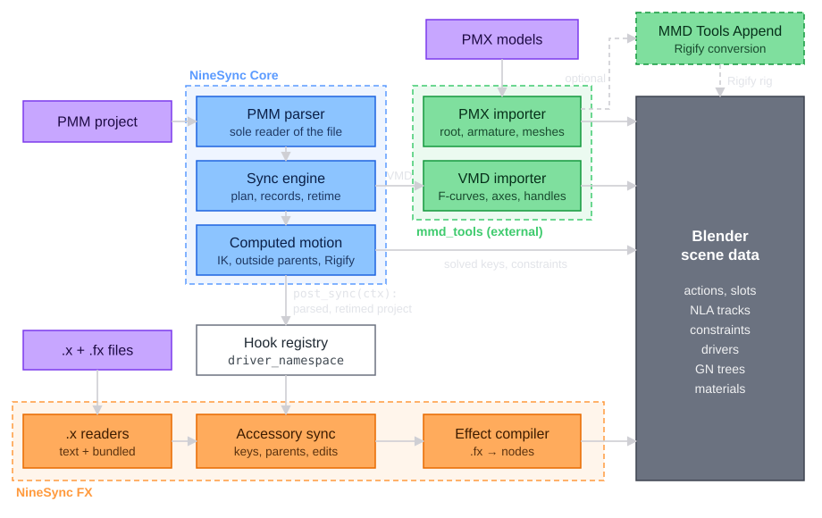

---
hide:
  - toc
---

# Manual

This manual can be read as needed, in any order. It documents usage, settings and limitations. Each feature also has an optional **"How X Works"** section at its end, which explains the deeper design decisions and its trade-offs for readers who want to know.

## How the parts fit together

Core reads the PMM and hands the motion to mmd_tools. FX builds the accessories and effects.

{ .no-lightbox }

## (Core) PMM Bridge

- [PMM Create](core/pmm-create/index.md): write an MMD project from your Blender scene.
    - [Compatibility Matrix](core/pmm-create/compatibility.md)
- [PMM Sync](core/pmm-sync/index.md): bring a `.pmm` into Blender and keep it up to date.
    - [PMM Reading and Writing](core/pmm-sync/reading-and-writing.md)
    - [Synchronization](core/pmm-sync/synchronization.md)
    - [Accessories and Effects in a PMM Sync](core/pmm-sync/accessories-and-effects.md)
    - [How PMM Sync Works](core/pmm-sync/how-it-works/index.md)
- [Rigify Remap](core/rigify-remap/index.md): carry PMM motion onto a Rigify rig.
    - [Creating Rigify Rig from MMD](core/rigify-remap/creating-rigify-rig.md)
    - [How Rigify Remap Works](core/rigify-remap/how-it-works/index.md)

## (FX) FX Importer

- [FX Import](fx/index.md): overview and reading order.
    - [Getting Started](fx/import.md)
    - [Geometry Nodes Setup](fx/geometry-nodes/index.md)
    - [Shader Nodes Setup](fx/shader-nodes.md)
    - [How FX Works](fx/how-it-works/index.md)
